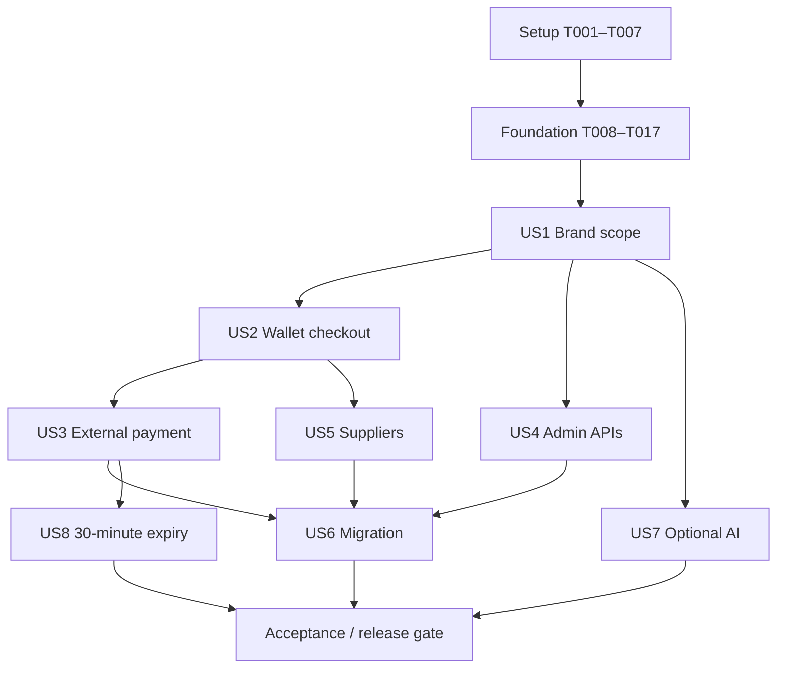

# Tasks: Multi-Brand Commerce Backend Redesign

**Current checkpoint — 2026-11-12:** T066 is complete for the full frozen-snapshot preservation and quarantine reconciliation. The three-brand application run and independent final review passed:219,909 source rows,18,231 originals/5,212 recovered fields,14,165 target projections and all28 table fingerprints; zero projection discrepancies. All16,348 quarantine dispositions,40 IRR accounts and7,502 histories remain preserved. **81/96 tasks complete;15 unchecked. T068 and release remain gated.** Financial obligations, ownership, delivery and current media availability remain unknown where evidence is absent. No CI or production change occurred. See [T066 qualification](../../ops/T066_RECONCILIATION.md) and [reviewed evidence](../../ops/evidence/t066-final-frozen-reconciliation-2026-11-12.json).

**Historical T066 report-format checkpoint — 2026-11-11:** explicit source-generated public JSON excludes monetary totals and batch identifiers; the synthetic migration artifact now uses it. Baseline218/final224 unit cases and the focused database artifact check pass, with zero-warning builds and formatting. This is not fresh protected-source financial qualification. T066/T068 stay unchecked,80/96 unchanged; no CI. See [report checkpoint](../../ops/T066_RECONCILIATION.md).

**Historical T064 checkpoint — 2026-11-11:** T064 is complete for protected historical import and preservation under the owner-approved quarantine policy. The current operator imported and replayed all three frozen sources into one shared disposable target; independent table/FK, exact full-row restore/restart, original-source integrity and controlled Telegram checks passed. **80/96 tasks complete; 16 unchecked. T066 and T068 remain open; release is unqualified.** See [T064 qualification](../../ops/T064_QUALIFICATION.md) and [redacted final evidence](../../ops/evidence/t064-final-preserve-quarantine-qualification-2026-11-11.json). Uncertain financial, coupon, delivery and media obligations remain preserved for review.

**Input**: [spec.md](spec.md), [plan.md](plan.md), [research.md](research.md), [data-model.md](data-model.md), [contracts/backend-contracts.md](contracts/backend-contracts.md), [quickstart.md](quickstart.md)  
**Scope**: **Backend only** — no admin/dashboard UI, frontend, or embedded AI answering service.  
**Historical wallet-only checkpoint (2026-11-06)**: T063 is complete. Actual wallet-only import/replay/reconciliation passed for all three pinned backups at `3094a9286e4f45562c298a83b8a135cc3e476f01`, [CI 42273845931](https://github.com/Farrokhzadeh/telegram-multi-bot-shop/actions/runs/42273845931): **998 .NET tests (170/708/120), 55 Python/15 Spec Kit checks and five Native AOT executables**, zero failures/skips and zero build warnings/errors. All 12282 wallets, three USD opening postings and 57 nonposting USD history rows matched; all 40 IRR balances and 7502 original history rows retain their exact protected treatment. Both disposable containers/data were removed; all 13 existing containers and original backups/keys/media remain unchanged. See [wallet qualification](../../ops/LEGACY_WALLET_RETENTION_QUALIFICATION.md#actual-protected-wallet-target-qualification--2026-11-06). **79/96 complete, 17 unchecked. T064/T066 remain open for complete historical archives/order/payment/coupon/delivery import, target re-encryption and full liability/exception parity; T068 remains separately gated and unexecuted.** No deployment, live operation, missing-term reconstruction, IRR conversion, ownership guess or paid-obligation waiver is inferred. Constitution 3.0.0, canonical typed/no-JSON 28 tables and the read-only reviewer checklist remain unchanged.

**Canonical review references:** [schema-contract.md](schema-contract.md), [requirements-traceability.md](requirements-traceability.md), [consistency-review.md](consistency-review.md). Schema fragments are authored as one complete baseline in T008; downstream story tasks qualify its contracts. Earlier future file paths are module targets, not existing files or permission for duplicate CREATE statements.

## Format

`- [ ] TNNN [P] [USn] Description with destination path`

- `[P]`: separable work touching independent paths after its prerequisites, not automatic permission to run parallel agents.
- `[USn]`: maps to the numbered user story in `spec.md`. Setup/foundational/polish tasks have no story label.
- File paths below are targets **to be created in the new repository**, not claims they currently exist.
- Tests for high-risk behavior are required by the specification and must use disposable/synthetic data.

## Phase 1 — Setup and source evidence

**Goal**: Establish a separate backend-only repository and evidence for the exact legacy contract. No production traffic.

- [x] T001 Initialize the user-created `Farrokhzadeh/telegram-multi-bot-shop` repository with `.specify/`, `specs/001-multibrand-redesign/`, `README.md`, and `.gitignore`; copy the agreed spec, plan, tasks and contracts without migrating old app code wholesale. Completed by the owner-authorized specification transfer on 2026-10-29; no application implementation.
- [x] T002 Create `Platform.sln`, `global.json`, and native-host project files under `src/Platform.Api/`, `src/Platform.BotHost/`, and `src/Platform.JobHost/`, targeting the approved .NET 10 SDK.
- [x] T003 [P] Create class-library project files in `src/Platform.Core/`, `src/Platform.Persistence/`, `src/Platform.Security/`, `src/Platform.Telegram/`, `src/Platform.Payments/`, `src/Platform.Fulfillment/`, and `src/Platform.Campaigns/` with inward-only dependencies.
- [x] T004 [P] Initialize `tests/Platform.UnitTests/`, `tests/Platform.IntegrationTests/`, `tests/Platform.ContractTests/`, and `tests/Platform.AotSmoke/` with a disposable Postgres fixture runner and fake Telegram/provider transports.
- [x] T005 [P] Add pinned package restore, formatting, security/secret scanning and Linux Native AOT publish+run workflow in `.github/workflows/backend-ci.yml`; fail on unexpected trim/AOT warnings.
- [x] T006 Capture a read-only inventory of legacy source model/DDL migrations, Fernet prefixes/key derivation, payment callbacks, supplier integrations, Telegram callbacks, job handlers and brand environment mapping in `specs/001-multibrand-redesign/contracts/legacy-source-inventory.md`; label source-only versus live evidence.
- [x] T007 Use the owner-selected same-production-server staging-plan.md to define release gates, exact staging identities/separation, immutable artifact rules and protected runtime evidence still required before cutover in `ops/RELEASE_GATES.md`; do not request or copy production keys yet. Use active constitution 3.0.0 and the latest consistency-review.md alignment result for E1 governance evidence; the applied amendments do not complete this operational task or any E2–E6 proof. Completed as a definition contract; actual staging identities and activation remain unverified.

**Checkpoint**: New repository foundation and offline source map reviewed; Native AOT skeleton publishes and runs against fake integrations.

## Phase 2 — Foundational (blocks all user stories)

**Goal**: Brand context, data transactions, secrets, encryption and durable effects are safe before commerce endpoints are added.

- [x] T008 Author and qualify the explicit canonical 28-table baseline in ops/migrations/0001_core.sql and the operator-invoked SchemaRunner. Define all tables/column types first, attach cyclic FKs/static guards second and validate them before services write; no daemon-startup DDL. Use protected external migration manifests plus a transactionally applied schema-revision metadata marker/catalog assertions, not an unapproved 29th history table. Story schema tasks assert/evolve this baseline rather than CREATE the same tables again. Verify no JSON/jsonb/EAV and exact finite money/ownership/state guards in RelationalSchemaTests after implementation authorization; E1/E3/E4 govern freeze/compatibility. Completed with disposable synthetic PostgreSQL 18.6 and a separately invoked Linux Native AOT tool; actual source import/live execution remain gated. See ops/SCHEMA_QUALIFICATION.md.
- [x] T009 Create parameterized Npgsql transaction factory, typed decimal/currency helpers and connection/lease error policy in `src/Platform.Persistence/DbSession.cs` and `src/Platform.Core/Money.cs`. Completed with exact non-rounding amounts, explicit positional bindings/private typed row projections, known-abort versus unknown-commit recovery and stale/expired/replaced lease row fences. Disposable PostgreSQL and Native AOT lost-acknowledgement probes passed; no scheduler or customer handler is implied. See ops/TRANSACTION_QUALIFICATION.md.
- [x] T010 [P] Add trust-bound brand identity (`BrandContext`) and reject customer-supplied brand switching in `src/Platform.Security/BrandContext.cs` and `src/Platform.Api/BrandContextMiddleware.cs`. Completed with immutable registered authentication-ticket identity, explicit customer endpoint metadata, bounded structural selector rejection, body preservation and concurrent request cleanup. Synthetic tests and actual Native AOT HTTP probes passed; production credential handlers, Telegram ingress and customer handlers remain later work. See ops/BRAND_CONTEXT_QUALIFICATION.md.
- [x] T011 [P] Implement versioned configuration loading and read-only per-service Docker secret file references for **per-brand keyrings and an independently authorized shared-inventory keyring** in `src/Platform.Security/SecretFiles.cs` and `ops/compose/backend.compose.yaml`; raw keys never appear in database, .env or logs.
- [x] T012 Implement new authenticated-ciphertext envelope with key ID, random nonce and integrity-bound scope/table/row/field identity in `src/Platform.Security/BrandCipher.cs` and `src/Platform.Security/InventoryCipher.cs`; per-brand secrets bind to brand and unsold shared stock binds to platform-inventory scope. No plaintext fallback.
- [x] T013 [P] Add migration-only Django Fernet adapter and previous-key/legacy prefix fixtures in `src/Platform.Migration/LegacyFernetReader.cs` and `tests/Platform.UnitTests/LegacyCipherTests.cs`; preserve source-compatible key derivation. Pure reader interoperability cases run in the unit suite and the published AOT probe; no real legacy keys/data were used.
- [x] T014 [P] Implement redacted structured logs, correlation IDs, error taxonomy and health/readiness policies in `src/Platform.Core/Errors.cs` and `src/Platform.Api/DiagnosticsEndpoints.cs`.
- [x] T015 Implement the canonical jobs/outbox over the T008 baseline in src/Platform.Persistence/OutboxStore.cs. Qualify the job-kind typed-origin matrix including shared product/source jobs, supplier request, authorization audit ID and expected origin revision; platform maintenance has no guessed customer brand. Transactional enqueue/dedupe/leases/retries are scheduler evidence, not remote purchase permission. Baseline FKs exist before foundation checks.
- [x] T016 Implement separate `admins`, `admin_sessions` and append-only `audit_events` with global authenticated admins, immediate revocation and redacted privileged-action logging in `src/Platform.Security/AdminAuth.cs`, `src/Platform.Persistence/AdminAuditStore.cs`, and `ops/migrations/0002_auth.sql`; no UI. Review verified staff Telegram identity linkage/revocation and per-brand public admin-contact FK under FR-081/082; group membership/customer claims never create backend privileges. Use the canonical two-channel possession challenge and current auth_version/revocation checks for staff Telegram binding; private group membership never substitutes for admin authentication.
- [x] T017 Validate T008–T016 with wrong-brand, wrong-inventory-key, forbidden bot access to shared inventory cipher, crashed-lease, repeated-write, zero-JSON database metadata and Native AOT executable checks in `tests/Platform.IntegrationTests/FoundationTests.cs` and `tests/Platform.AotSmoke/NativeHostSmokeTests.cs`.

**Checkpoint**: Authenticated brand context, new crypto, legacy reader, typed SQL and durable outbox pass synthetic failure-injection tests. Do not proceed if brand checks can be bypassed.

## Phase 3 — User Story 1: Independently branded customer experience (P1) — MVP

**Goal**: Three bot identities can represent separate customer accounts and data without disclosure of shared ownership.

**Independent Test**: The same Telegram ID appears in all three brands with different balances, languages, orders, blocks and callback states; every customer query stays scoped and a never-started bot cannot message that user.

- [x] T018 [P] [US1] Write brand isolation and forged-callback tests in `tests/Platform.IntegrationTests/BrandIsolationTests.cs` and `tests/Platform.ContractTests/TelegramContextTests.cs`.
- [x] T019 [US1] Qualify the baseline typed-policy `brands` (one encrypted bot token per brand), `brand_channels`, and `users(id PK, brand_id, telegram_id BIGINT, UNIQUE (brand_id,telegram_id), UNIQUE (id,brand_id))` with revision-guarded private-DM `users.flow_*` fields in `ops/migrations/0003_brands_users.sql`. `users.id` is a **brand membership**, never global customer identity. **Owner confirmed DM-only interactions; no `telegram_sessions` table in v1.** Follow [database-table-review.md](database-table-review.md). Canonical field/type/key authority is schema-contract.md; this task qualifies the complete T008 baseline and implements feature behavior/tests, not a duplicate table creation or an unapproved extra relation.
- [x] T020 [P] [US1] Implement per-brand user/settings/state repository with enforced composite scope, a single revision-guarded active private-DM flow per brand membership, and `users.telegram_id` private-chat destination lookup in `src/Platform.Persistence/BrandUserStore.cs`.
- [x] T021 [P] [US1] Implement channel membership rule checks and per-brand localized text/asset lookup in `src/Platform.Telegram/BrandPolicy.cs` and `src/Platform.Telegram/Localization.cs`. Localize FR-075 Out-of-stock status for published supplier listings without exposing raw provider errors. Add localized one-time restock opt-in/unsubscribe labels and informational availability notice without promised dates (FR-076). Implement verified-staff exemption and audited per-brand require-channel enforcement bypass; preserve configured channels and brand-scoped public contact (FR-081/082).
- [x] T022 [US1] Implement verified Telegram update ingestion, brand-scoped command/callback routing and per-bot consumer ownership in `src/Platform.Telegram/UpdateRouter.cs` and `src/Platform.BotHost/Program.cs`. Route FR-076 subscription controls with membership/product brand checks and callback idempotency, after final approved-table-28 persistence review.
- [x] T023 [US1] Test no foreign brand identifiers, assets, wallets, orders, links or support context appear in any response; add blocked/never-started behavior in `tests/Platform.IntegrationTests/BrandOutputTests.cs`. Verify SC-044 visibility/publication separation and brand-scoped unavailable listing output. Add SC-045 restock-consent and notice brand-isolation/nonfinancial checks.
- [x] T024 [US1] Qualify the baseline brand-scoped `support_tickets` and append-only `support_messages` with staff assignment, replies, media references and lifecycle constraints in `ops/migrations/0003_support.sql`. Canonical field/type/key authority is schema-contract.md; this task qualifies the complete T008 baseline and implements feature behavior/tests, not a duplicate table creation or an unapproved extra relation.
- [x] T025 [US1] Implement human support ticket/reply routing and durable staff/customer notifications independent of AI, including FR-070 paid-preorder cancellation discussions through checked existing order-linked tickets without a dedicated cancellation endpoint/button or automatic order/queue/financial mutation in `src/Platform.Telegram/HumanSupportRouter.cs` and `src/Platform.Persistence/SupportStore.cs`.
- [x] T026 [US1] Verify support ticket creation, staff reply, AI-off operation, brand scoping and worker restart, plus SC-039 same-owner order links and creation/reply/assignment/closure/reopening/replay causing no order/queue/coupon/money/stock change in `tests/Platform.IntegrationTests/HumanSupportTests.cs`.

**Checkpoint**: Backend-only brand-isolation MVP works against synthetic data, with no live Telegram connection.

## Phase 4 — User Story 2: Atomic last-item wallet purchase (P1)

**Goal**: Exactly one buyer receives a shared last item with one debit and durable delivery.

**Independent Test**: 50 concurrent buyers, one available credential; exactly one order/debit/allocation. Crash between DB commit and Telegram send causes no second charge.

- [x] T027 [P] [US2] Write last-unit race, insufficient balance, rollback and replay tests in `tests/Platform.IntegrationTests/AtomicCheckoutTests.cs`.
- [x] T028 [US2] Qualify the baseline no-JSON `products`, `brand_products` (typed `price_usdt`, `price_toman`, `auto_price_toman`, payment rules and inherit/override/clear overrides), `inventory_items`, **USD-only `wallets(user_id PK)` and immutable `wallet_entries(user_id FK)` without currency columns**, and one-product `orders(user_id,quantity,unit_price_usdt,nullable unit_price_toman/FX snapshots,discount/rounding calculation version,currency,payment_method,payment_due_at,typed product snapshot)` in `ops/migrations/0004_commerce.sql`. **No `orders.total_usdt`, `orders.total_toman`, `orders.brand_id`, `orders.telegram_id`, pricing-mode enum or `payable_usd`.** DB-level brand-match guard must verify `orders.user_id` against `brand_products` and coupons. Do not remove historical `order_items` until source inventory proves safe. Apply approved FR-083 sole orders.id public reference without new public_ref, with preserved legacy alias evidence; review FR-078 local-first policy/snapshot and FR-079 typed active-hold fields. Canonical field/type/key authority is schema-contract.md; this task qualifies the complete T008 baseline and implements feature behavior/tests, not a duplicate table creation or an unapproved extra relation.
- [x] T029 [US2] Document verified `main` code semantics in `specs/001-multibrand-redesign/contracts/legacy-commerce-policy-matrix.md`: automatic `best_discount`, one code's `max_uses/current_uses`, product/assigned-user eligibility, both USDT/toman quote paths, Nobitex RLS/10, hourly fetch, ceiling-to-5,000-toman rounding, staleness, `auto_price` opt-out, topup policy and regional payment restrictions. **Verify standalone `PaymentAttempt.kind='wallet_topup'` with nullable order and preserve its typed funding origin.** Record the intentional change from partial coupon use to quantity-entry validation and approved **immutability of each order's payment method/currency**; retain USD wallet units and frozen USDT-to-USD internal credit mapping. Lock **crypto-only wallet top-ups**, TOMAN-only bank/card order settlement and NOWPayments crypto order payment while retaining existing per-brand topup eligibility policy.
- [x] T030 [US2] Implement typed `discounts`/`discount_uses` preserving **one code with bounded remaining quantity** and one account-bound N-use code per fully paid future-unit purchase (separate batch generation only for campaign/goodwill), prepaid provenance, goodwill/marketing percentages, product/assigned-user scope, server-keyed lookup digest **plus brand-encrypted code for authorized My Discounts/notification display**, guess-rate limits and atomic use caps; add typed signed `discounts.usage_adjustment_units DEFAULT 0` so owner-set effective-used overrides do not mutate real redemption history. **For new prepaid codes require non-null `eligible_user_id`, `product_id`, `source_order_id` with brand/customer/source-paid-order checks: codes are NOT transferable or usable across memberships/brands; promo/goodwill may retain nullable eligibility.** `discount_uses.status` MUST support `held/redeemed/released`, with external-payment holds countable alongside `discounts.redeemed_count` under a serialized coupon lock and no stock reservation; old claims remain auditable. Implement current FX/fetch/lease metadata in `brands` (not `exchange_rates`), source-equivalent Nobitex USDT/RLS conversion and hourly refresh, 5,000-toman ceiling, stale-rate checks and product `auto_price_toman` opt-out in `src/Platform.Core/PricingPolicy.cs`, `src/Platform.Persistence/PricingStore.cs` and `ops/migrations/0004_pricing.sql`; no JSON or historical rate table. Canonical field/type/key authority is schema-contract.md; this task qualifies the complete T008 baseline and implements feature behavior/tests, not a duplicate table creation or an unapproved extra relation.
- [x] T031 [P] [US2] Implement automatic best eligible **whole-quantity-covering** coupon selection for every 10%, 50% and 100% code (no customer opt-out and no partial `min(qty,remaining)`), return `quantity_exceeds_discount_limit` with maximum before order creation **after subtracting effective used (`max(0,redeemed_count + usage_adjustment_units)`) and temporarily held units, clamping new availability to zero even after an owner-imposed overcommitted cap**, USDT/toman calculations using the legacy rounded-rate order, and typed immutable `orders` quote input snapshots (`unit_price_usdt`, nullable toman unit/rate, source/fetched-at, rounding step/calculation version, `currency`, `payment_method`, product text) in `src/Platform.Core/CheckoutQuote.cs`; compute totals from inputs without storing them on orders. Apply FR-077 direct selected-supplier stock/cost/eligibility refresh before new supplier quote/order creation; do not independently overwrite brand retail pricing or old quote snapshots. Coupon claim creation rechecks current capacity; fulfillment validates the original protected held claim, not new-checkout cap/expiry eligibility after an owner edit.
- [x] T032 [P] [US2] Implement product field states `inherit/override/clear`, per-brand visibility and independent USDT/toman price with `auto_price_toman` boolean, retaining manual toman values when automatic conversion is disabled, in `src/Platform.Persistence/CatalogStore.cs`. Apply FR-075: preserve published listings as Out of stock when the selected shared supplier source is unavailable, derive purchase eligibility without changing visibility settings, and block stale new-checkout paths before hold/debit/invoice/zero-due acceptance. After final approved-table-28 constraint review, integrate FR-076 verified availability transitions with durable opt-in evaluation, no automatic publication and local paid-FIFO-first availability. Evaluate local-first availability under FR-078: eligible local coverage bypasses supplier outages; supplier validation covers only remote need, while unpublished listings stay hidden. Catalog availability combines eligible local supply and selected-source remote need, not unconditional supplier status. Manual publication remains authoritative.
- [x] T033 Implement the canonical order_kind/route dispatcher in WalletCheckoutService.cs, OrderIds.cs and CheckoutStore.cs: immediate local-only full allocate/debit/redeem or zero effects; local-first mixed accepted paid local units plus positive bound supplier remainder/whole coupon hold; local-preorder accepted FIFO; prepaid_units paid source settlement issues one N-use entitlement. Fresh supplier evidence is required only for remote need. Deterministic membership/product/coupon/wallet/order locks, optimistic revisions and request idempotency prevent duplicated effects; invalid excess coupon quantity creates no order. No provider/Telegram call inside the transaction and no partial customer release. Test SC-002/011/025/026/042/047/052.
- [x] T034 [US2] Implement FR-015 complete-manifest credential delivery over the existing outbox in `src/Platform.Fulfillment/LocalDeliveryWorker.cs` and `src/Platform.Persistence/DeliveryStore.cs`. Prefer `action=edit` against an existing order message whose bot/member/order/target_message_id is validated and durably saved; recheck current order state and immutable manifest generation before dispatch. Save available outcomes, suppress known successful sends and retry the same target/intent. Missing/uneditable anchors or file/multi-part delivery use explicit recovery handling; no silent replacement-send fallback. Persist uncertain new-message outcomes as recovery-required and pause automatic resending without guessing success; preserve protected access and the paid obligation. Add SC-004/036 synthetic crash-after-edit, stale/wrong target, lost result, definite failure, known-success suppression and exception-recovery checks. No repeated purchase/debit/allocation/coupon effect and no exactly-once remote/read guarantee.
- [x] T035 [US2] Prove atomicity under restarts, 50-way concurrent checkout and three-brand shared inventory access in `tests/Platform.IntegrationTests/CheckoutCrashAndRaceTests.cs`.
- [x] T036 [US2] Verify two simultaneous redeemers, a **single 100%-off code with 10 uses** prompting maximum-quantity correction for 11 without creating an order in BOTH USDT and toman, quantity 10 succeeding atomically with stock, one 100-unit paid-source purchase issuing exactly one 100%-off code, then 1+9+20 unit redemptions leaving 70 remaining, automatic coupon selection without opt-out, zero-wallet free checkout, coupon nonconsumption on no-stock, 10/50% marketing caps rejecting 11 units when only 10 discounted uses remain, and allowing an audited owner override that lowers a cap below redeemed+held while preserving already held orders, not making mixed-price orders, Nobitex RLS/10, exact 5,000-toman upward rounding *after* automatic discount, hourly/stale-rate handling, disabled auto-price retaining manually set toman **while still accepting independently priced USD wallet/USDT crypto checkout**, and per-brand payment/topup policy in `tests/Platform.IntegrationTests/RegionalPricingTests.cs`. Also test an assigned prepaid coupon is visible and redeemable only by the *original paid source order's* `users.id`; leaked code text, another member in that brand and the same Telegram ID in another brand cannot reveal, hold or redeem it.

**Checkpoint**: Money/stock invariants pass real disposable PostgreSQL tests and compiled Native AOT smoke.

## Phase 5 — User Story 3: Crypto and manual external payments (P1)

**Goal**: Immediate local-only (non-preorder) crypto-paid-but-out-of-stock cases never lose funds or become fictitious completed orders.

**Independent Test**: For a live immediate local-only product_purchase, replay 100 copies of the same paid crypto callback after full local allocation fails; exactly one **USD wallet** credit numerically equal to the frozen discounted USDT `payments.amount_due`, **one release of the order's held coupon uses**, zero final coupon redemptions and zero allocations. Paid manual receipt awaits restock indefinitely unless an admin resolves it.

- [x] T037 [P] [US3] Write provider-signature, delayed/repeated settlement, quote-vs-token, and no-stock compensation tests in `tests/Platform.ContractTests/PaymentCallbackTests.cs` and `tests/Platform.IntegrationTests/ExternalPaymentTests.cs`.
- [x] T038 [US3] Qualify the baseline no-JSON `payments` for order-linked NOWPayments crypto/TOMAN bank settlement **and standalone crypto-only wallet funding** using nullable `order_id` and nullable `topup_user_id` FK → `users.id`, with database `CHECK (num_nonnulls(order_id,topup_user_id)=1)` and brand/method checks. For new crypto payments, require `network_asset IN ('USDTTRC20','USDTBSC')`, with source-legacy exceptions recorded only through isolated migration/reconciliation policy. Use canonical `payment_method`, `quote_currency` and exclusive typed origin; retain nullable `legacy_kind` solely as mapped historical evidence plus protected source denomination mappings until E3 proves fidelity. No target kind enum drives new payment logic. Preserve immutable USD/topup quote, `amount_due/amount_received`, actual `network_asset/network_amount`, scalar NOWPayments IPN verification evidence + protected immutable evidence refs, manual receipt proof/review, before-deadline first-observed evidence, source-linked **USD-wallet** compensation, provider/idempotency uniqueness and checked source-specific states in `ops/migrations/0005_payments.sql`. Canonical field/type/key authority is schema-contract.md; this task qualifies the complete T008 baseline and implements feature behavior/tests, not a duplicate table creation or an unapproved extra relation.
- [x] T039 Implement verified NOWPayments settlement for the one shared merchant account. Topup credits the exclusive original membership once. Dispatch order settlement by immutable order_kind/route: immediate local-only allocation or the approved full net USD shortage credit/full claim release; mixed/supplier accepted procurement retains source/review under FR-066/073/078/080; local preorder retains FIFO; paid prepaid_units issues its one entitlement. Handle fully verified full-value late USDT against original expired/replaced invoice with the approved original-wallet credit, no revival. Under/excess/wrong-network/unknown receipts remain reviewed. Tests cover SC-003/018/019/022/027/035/042/047/049.
- [x] T040 [US3] Implement manual receipt state machine: submitted, denied-unverified, confirmed-paid, allocated, paid-unfulfilled (no expiry), explicit auditor-traceable administrator off-bot resolution (NO external refund execution, recording or inference in AccAbad; hold remains until separately authorized staff order-state action) in `src/Platform.Payments/ManualDepositService.cs`. Each Iran brand has **exactly one distinct active encrypted receiving card** on `brands`; the **last successfully saved, revision-checked** card immediately becomes the only destination for **new orders**, with stale concurrent admin writes rejected. Bank-payment `payments` freezes its **exact encrypted card/holder destination** before showing instructions; receipt review of earlier pending orders uses that immutable snapshot and original 30-minute deadline even after card replacement. Reject reused active bank-card fingerprints and cross-brand destination access; the international brand need not have a bank card.
- [x] T041 [US3] Add compensation and receipt status read APIs with no automatic on-chain refund claims in `src/Platform.Api/PaymentEndpoints.cs` and `src/Platform.Api/ManualDepositEndpoints.cs`.
- [x] T042 [US3] Validate no duplicate **internal USD-wallet credit**, no erased paid liability, repeated approval idempotence and **crypto no-stock compensation atomically returning held discount uses** (e.g., $10 product, 50%-off code, $5 USD wallet credit, one returned coupon use, no stock allocation, no `redeemed_count` increment). Freeze the test clock around coupon expiry: a valid 11:55 PM original held order may fulfill after a midnight campaign expiry, while an order compensated after expiry releases capacity but cannot reuse or renew the expired marketing coupon; no automatic replacement issue, clear notice, and a separately paid 100%-off future-unit entitlement (`ends_at IS NULL`) remains valid. Scope shortage/expiry examples to immediate local-only goods; verify supplier/mixed and local-preorder dispatch never enters that automatic-shortage branch. Test 100 late-callback replays auto-crediting one original-brand USD wallet once while old order remains cancelled/expired, and anomalies requiring staff review. Implement in `tests/Platform.IntegrationTests/PaymentStateMachineTests.cs`.

**Checkpoint**: Paid obligations are durable, provider evidence verifiable, compensation exactly once.

## Phase 6 — User Story 4: Unified administration backend (P1)

**Goal**: All brands managed through one secure API, with no graphical UI.

**Independent Test**: One authorized API principal configures all three brands, encrypted bot tokens, required channels, products and overrides, receipts, wallet adjustments and campaigns; ordinary reads reveal no secrets.

- [x] T043 [P] [US4] Write admin authorization, token-redaction, idempotency and audit contract tests including unrestricted owner edits to coupon percent/caps/effective usage/validity dates even below redeemed+held and on prepaid entitlements, with actor/reason/old-new audit and immutable historical redemption rows in `tests/Platform.ContractTests/AdminApiTests.cs`.
- [x] T044 [US4] Implement encrypted write-only bot token lifecycle and required-channel configuration in `src/Platform.Api/BrandEndpoints.cs` and `src/Platform.Security/BotTokenVault.cs`.
- [x] T045 [US4] Implement brand policies and shared catalog/override/price/inventory endpoints in `src/Platform.Api/CatalogEndpoints.cs`.
- [x] T046 [US4] Implement brand/global order search, payment receipt decisions, wallet adjustment and pending-restock/preorder resolution under FR-070 outside-shop cancellation repayment policy (no cancellation wallet credit/debit reversal or external payout execution/records; retain original payment history) with atomic exactly-once release of all still-held coupon uses (unchanged coupon terms/expiry and no release of redeemed claims), and separately reviewed admin state/hold representation (audited and serialized with allocation; no financial inference from support text/status) and unrestricted owner coupon-edit endpoint for percentage, usage caps, effective used count (`usage_adjustment_units`), expiry/start dates, active state and brand-scoped eligibility (no cap floor or prepaid settlement veto; no automatic off-bot coupon inference) in `src/Platform.Api/OrderAndWalletEndpoints.cs`. Add FR-079 blocking hold/resume and FR-080 explicit safe retry/terminal wallet credit with actor/reason/revision/idempotency; bank credit takes explicit confirmed USD amount, original funds/history remain, and retry/credit/delivery race to one outcome. Resolution command UUID is a unique audit identity; changed-input replays conflict. Safe retry work carries exact request authorization audit/revision; bank USD credit is explicit input, never automatic FX.
- [x] T047 [US4] Implement admin audit, campaign, worker health and backlog endpoints in `src/Platform.Api/OperationsEndpoints.cs`.
- [x] T048 [US4] Freeze generated API contract and ensure pagination/error shapes/permissions in `src/Platform.Api/OpenApiContract.cs` and `tests/Platform.ContractTests/AdminApiSnapshotTests.cs`.
- [x] T049 Qualify T008 campaign, stock-subscription and delivery schema contracts, then implement persistence in src/Platform.Persistence/CampaignStore.cs. Keep one brand/language campaign per launch variant and unique launch/member recipients. Customer rows derive private target from membership; staff metadata notices use recipient_kind=staff_chat and a trusted configured staff_chat_id, with checked recipient/purpose XOR. Add typed stock-subscription/supplier-case/audit origins and immutable manifest generation/part uniqueness; no customer-purpose group destination or new waiting-consent table beyond approved table 28.
- [x] T050 [US4] Implement persisted audience materialization into per-campaign `telegram_deliveries` with independently scoped brand/language, typed audience criteria, subscription eligibility and consent snapshot in `src/Platform.Campaigns/AudienceMaterializer.cs`.
- [x] T051 [US4] Implement throttled, resumable per-bot sender over unified `telegram_deliveries` with **private `chat_id` derived from the recipient's `users.telegram_id`**, Telegram 429 backoff, durable jobs, remote message ID and explicit uncertain-outcome handling after crash-after-send in `src/Platform.Campaigns/BroadcastWorker.cs` and `src/Platform.Persistence/CampaignStore.cs`. Reuse this sender for one-time opted-in restock notices, rechecking consent/publication/stock before first send, deferring the same alert if stock disappears, with existing retry/blocked/uncertain-send handling (FR-076). Route staff metadata notices to the configured private shared staff chat under FR-082, separately from customer DM derivation; protected bonus retrieval still requires current independent staff authorization. Use immutable order manifest generation/part guards and recipient-kind dispatch; customer DMs and trusted staff-chat metadata notices are separate branches. Credential delivery follows T034: prefer the saved order-message edit and pause uncertain new credential sends for explicit recovery; do not silently replace them with another message. Campaign/restock/staff purposes keep their separately qualified delivery policies.
- [x] T052 [US4] Verify campaign cancellation, one recipient per eligible brand **per batch across different language variants**, repeated enqueue, blocked user, 429 and crash/restart delivery in `tests/Platform.IntegrationTests/BroadcastRecoveryTests.cs`; distinguish uncertain remote receipt from duplicate database obligations; include T034 saved-anchor edit recovery, stale payment-edit races and paused uncertain credential sends without silent replacement messages (SC-004/036). Add SC-045 repeated transitions/restart/cancellation/re-opt-in, lost-stock-before-send, no reservation/payment/order/coupon mutation and no duplicate logical-alert checks. Add FR-082 staff-recipient isolation and SC-053 closed_at 180-day subscription cleanup with coordinated terminal restock-only evidence, active preservation and independent replay protection. Coordinate closed-subscription 180-day cleanup only with terminal restock-specific delivery/job evidence, protect all unrelated domain history, and keep business replay checkpoints independent of either 180-day table.

**Checkpoint**: Backend administration is operable from authenticated API clients; no UI project exists.

## Phase 7 — User Story 5: Supplier fulfillment reconciliation (P1)

**Goal**: External API uncertainty never causes silent duplicate fulfillment or premature compensation.

**Independent Test**: Supplier timeout-after-success, confirmed failure and delayed success use one stable external request key and reconcile to one terminal outcome.

- [x] T053 [P] [US5] Write supplier success/failure/unknown and timeout-after-success replay tests in `tests/Platform.ContractTests/SupplierContractTests.cs`. Include FR-072 / SC-041 bonus, no-bonus, ambiguous-extra, duplicate/reordered response and customer/admin isolation fixtures.
- [x] T054 [US5] Qualify the baseline one-to-many `supplier_requests(order_id,requested_quantity)` → per-unit `fulfillments(supplier_request_id)` with same-order guards, brand-key encrypted delivered supplier content, stable local supplier intent reference (remote idempotency only when proven), immutable selected source/account/product/variant snapshots, partial/unknown state and protected immutable evidence pointers in `ops/migrations/0006_suppliers.sql`; no provider-state JSON. Also create the owner-approved attempt history from T090. Review typed admin-bonus versus customer-unit attribution and encrypted acquisition storage before DDL; no extra customer unit rows or new table is implicitly approved (FR-072). Review FR-074 immutable acceptance-time supplier-cost amount/currency/quote evidence and typed request-specific override-ceiling/blocker fields in existing relations before DDL; no new table is implied. Keep positive supplier-remainder quantity and actual per-unit mixed provenance; review typed financial resolution/ledger origin and blocking-hold fields within existing tables (FR-078–080). Canonical field/type/key authority is schema-contract.md; this task qualifies the complete T008 baseline and implements feature behavior/tests, not a duplicate table creation or an unapproved extra relation. Admin-only supplier bonuses use admin_held inventory with typed request/item identity; capture is serialized and disjoint from customer fulfillments, without an extra bonus table.
- [x] T055 [US5] Define provider-neutral `ISupplierAdapter` with stable request ID, result categories and status query in `src/Platform.Fulfillment/ISupplierAdapter.cs`.
- [x] T056 [US5] Implement durable supplier request worker, lease/retry and unknown-result reconciliation in `src/Platform.Fulfillment/SupplierFulfillmentWorker.cs` and `src/Platform.Persistence/SupplierRequestStore.cs`. Route actually verified bonus items to protected admin access with durable, replay-safe attribution; exclude bonus content from customer manifests and ordinary logs/notices, with no extra purchase or automatic stock admission (FR-072). Apply FR-073 zero-due supplier checkout work without admin approval or payment callback, preserving the accepted source/held claim and existing uncertain-outcome reconciliation. Enforce FR-074 inclusive 10% increase against the original same-currency acceptance baseline, including 100%-off orders; block larger/unverifiable cost for admin review without reprice/fallback/compensation or baseline reset, and require an enforceable provider charge ceiling. Apply FR-078 remainder-only procurement and FR-080 admin retry after proven safe reconciliation; never rebind to later local stock or retry an uncertain acquired obligation blindly.
- [ ] T057 [US5] Add provider-specific adapters only after sanitized source contract and capability-specific reconciliation/idempotency evidence in `src/Platform.Fulfillment/Providers/`; document provider behavior in `specs/001-multibrand-redesign/contracts/supplier-provider-matrix.md`. Enforce FR-068 ready-account/key/code-only eligibility for exact product/variant at mapping publication and pre-purchase, reject input-collecting activation/slot/upgrade/manual/custom/unknown flows before payable checkout, and retain post-payment type changes for FR-066 administrator review. Specify SC-037 eligibility/type-change fixtures in `tests/Platform.ContractTests/SupplierContractTests.cs` before implementation. Apply owner-approved option A (2026-11-04): a verified fresh exact-source price check within the inclusive immutable 10% allowance permits uncapped purchase; a remote cap is optional and must never be falsely asserted. Verify actual over-limit receipt retention/review and original-attempt recovery. Implement FR-077 read-only direct product refresh before order creation using verified exact product/variant response shapes (fresh product-list read allowed when no detail endpoint exists), failing closed on read/rate-limit/parse errors without provider purchase. E2 is per provider: require authoritative currency, item identity/recovery, safe remote keys and the approved fresh local price guard; do not infer live capability from staging code or an attempted public-doc lookup.
- [x] T058 [US5] Prove money/fulfillment consistency under duplicated callbacks, unknown/partial batch outcomes and protected paid-unfulfilled remainders in `tests/Platform.IntegrationTests/SupplierRecoveryTests.cs`; never blindly re-purchase the remaining units. Verify SC-041: five customer units plus one protected admin bonus when proven, no customer/bonus overlap, no duplicate bonus or changed order/payment/coupon quantity, no secret leakage, and unchanged complete-order gating. Add SC-042 zero-wallet/full-coupon acceptance, concurrent coupon/source validation, replay, post-acceptance blocker, held-until-full-fulfillment and no fabricated money/invoice/expiry-job checks. Add SC-043 10.00→11.00 allowed / 11.01 blocked, decreases, quantity/fees/currency, free-coupon orders, invalid baselines, nonrolling retry costs, persisted review/override and price-change-at-submit/unknown-outcome fixtures. Add SC-047/049 mixed quantities, zero-remote outage exemption, credit-vs-retry/delivery races, explicit bank USD input, zero-due no-fictitious-credit and immutable original source/cost/attempt evidence. Test local-only shortage versus supplier/mixed retained review, prepaid issuance versus goods routing, and safe retry key/credit races; no generic immediate-crypto branch may compensate a mixed order.
- [x] T059 [US5] Document the approved FR-080 supplier-failure policy and provider/payment-specific validation in `specs/001-multibrand-redesign/contracts/supplier-failure-policy.md`: notify the private staff chat, permit only explicit reconciled bound-source retry or audited same-brand wallet credit, use original net USD for wallet/crypto and admin-confirmed USD input for bank payments, serialize terminal credit against procurement/delivery and return held claims. Unknown effects require reconciliation; no automatic credit/retry, fictitious zero-due payment or external refund execution/recordkeeping.
- [x] T060 [US5] Implement confirmed supplier failure as an auditable retained paid liability and no duplicate compensation, with tests in `src/Platform.Fulfillment/SupplierFailurePolicy.cs` and `tests/Platform.IntegrationTests/SupplierFailureTests.cs`. Implement approved FR-080 explicit safe retry or terminal same-brand wallet-credit decisions, alerts, full held-claim release, bank-entered USD and exactly-once typed ledger/audit links; no automatic supplier compensation.

**Checkpoint**: Supplier timeouts remain pending reconciliation, not blind refund or duplicate issue.

## Phase 8 — User Story 6: Brand-by-brand historical migration (P1)

**Goal**: Safe, repeatable migration of three independent source databases into one brand-neutral backend with new per-brand encryption keys.

**Independent Test**: Import redacted source fixtures twice with duplicate IDs across stores; counts and opening balances are unchanged on rerun, all required ciphertext decrypts with new key only, and staged stop/snapshot/release is reversible.

- [x] T061 [P] [US6] Write key-rotation, wrong-key, collision and rerun tests in `tests/Platform.IntegrationTests/LegacyMigrationTests.cs`, reusing legacy Fernet golden fixtures from T013 rather than duplicating a second cipher test suite.
- [x] T062 Use the baseline legacy_id_map primary/public_order_reference key distinction and checked canonical targets for repeat-safe imports. Store protected immutable source/batch manifests outside the business DB; recover checkpoints from committed mappings/source fingerprints and the manifest. Target write and mapping commit together. Do not add import-checkpoint/batch tables or discard historical aliases; prove replay/collision/resume with T064/T069.
- [x] T063 [US6] Implement read-only source adapters and source schema validation against approved protected copies in `src/Platform.Migration/LegacySourceReader.cs`; fail if migrations/schema differ from expected.
- [x] T064 [US6] Implement repeat-safe historical users/wallet/ledger/orders/payments/coupon obligations/delivery import in `src/Platform.Migration/ImportWorkflow.cs`: verify legacy order line cardinality before omitting `order_items`, freeze one authoritative **USD** wallet opening balance per brand/user membership, preserve historical ledger as non-posting evidence (or verified complete replay, never both), **preserve legacy USD wallet denomination; hard-stop and explicitly reconcile any discovered non-USD wallet liabilities rather than silently coercing them into USD**, preserve encrypted discount codes and current `max_uses/current_uses` even if historical redemptions cannot be fully reconstructed, retain source provenance and prepaid voucher source payments, **hard-stop or quarantine unowned/historically shared prepaid codes for auditable ownership reconciliation rather than guessing an `eligible_user_id`**, import only Brand A active master catalog, and no active stock.
  - **Owner decision, 2026-11-09, option B:** all original orders, including the 3,997 protected exceptions, must ultimately be visible to the exact brand/member as read-only historical entries with verified original fields and missing values marked unknown. No cross-member access, duplicate typed/imported order, inferred settlement, payment or re-delivery. The new authenticated archive customer projection is a preliminary slice; secure runtime serving, pagination, deduplication and complete protected qualification remain open. See [customer-history contract](../../ops/LEGACY_RECORD_IMPORT.md#owner-approved-customer-history-visibility-option-b--2026-11-09).
  - **Owner confirmation, 2026-11-09, financial option A + authorized-account option A:** show every original order only to its authenticated brand/member with verified fields and unknown statuses; preserve and quarantine all ambiguous payment/delivery/IRR and unassigned-coupon obligations without inferred settlement, payment, refund, coupon redemption or delivery. All 21 source-unassigned coupon records remain out of the operational target until independently attributed; no relabeling as promotion or goodwill. Qualify real-history Telegram visibility only in isolated read-only staging with two explicitly identified, owner-controlled consenting accounts, verified private chat bindings, one-shot sends, no automated retries or production bot changes. Approval of test *method* does not supply the account identities or authorize arbitrary customer messaging. Continue `[skip ci]` local/offline work and leave T064/T066/T068 unchecked until their gates pass.
  - **2026-11-09 owner refinement: one authorized account:** the owner supplied one consenting private Telegram test recipient, whose original immutable `User` proofs and separate protected encrypted member histories were verified for `acc-abad`/prod1 and `zikotech`/prod3; no matching `User` proof exists for `kuala`/prod2 and it must not be tested. This supersedes the earlier proposed requirement for two real recipients; synthetic negative-member cases remain required. Isolated no-network .NET decryption/page rendering passed for both brands, including foreign-member and foreign-brand rejection; the staging bot's private-chat metadata was verified read-only. A real-history Telegram send was blocked before execution: no attempt marker or message was made, and live `/orders` qualification remains open. Never publish the owner account ID or member mappings; no CI, production mutation or release qualification follows. See [redacted single-account checkpoint](../../ops/evidence/t064-single-owner-history-qualification-no-ci-2026-11-09.json).\n  - **2026-11-09 actual protected history-projection checkpoint:** all 4,916 original orders were authenticated and preserved as customer-safe new-brand-key encrypted per-member history snapshots across all 12,282 memberships. Three source-only native runs and fresh-process replays passed with immutable private ciphertext/receipt equality; see [redacted evidence](../../ops/evidence/legacy-customer-history-validation-2026-11-09.json). This is **not** live customer visibility or typed-order deduplication. Financial obligations, provider/delivery state and cutover remain separately gated; leave T064/T066/T068 unchecked.
- [x] T065 [US6] Implement record-wise legacy decrypt → new per-brand authenticated encryption for brand-owned data **or** platform-inventory encryption for authorized shared credentials → decrypt-and-compare, with no plaintext export, in `src/Platform.Migration/ReencryptionWorkflow.cs`; cover retained old previous keys.
- [x] T066 [US6] Generate redacted reconciliation of wallet balances, paid obligations, historical snapshots, ciphertext counts and unmatched rows in `src/Platform.Migration/ReconciliationReport.cs`. Completed for the frozen preservation/quarantine scope after the full protected-copy run and independent final review; [qualification](../../ops/T066_RECONCILIATION.md). Financial/release verification flags remain false; T068 stays gated.

T063/T064/T066 offline record extension: [contract and remaining gates](../../ops/LEGACY_RECORD_IMPORT.md). Complete-record readers, protected archives, historical order/payment/coupon/catalog projections, delivery/service/supplier/refund evidence, member restrictions and record/ciphertext reconciliation have synthetic managed/native qualification paths. Exact-commit CI supplies execution evidence. Keep these tasks unchecked until approved protected-copy schema/record coverage and the complete historical liability/ownership/partial-order matrix pass; neither an archive match nor synthetic success qualifies release.

2026-11-05 authorized actual-backup checkpoint: [redacted assessment](../../ops/PRODUCTION_BACKUP_RECONCILIATION.md) and [aggregate inventory](../../ops/evidence/legacy-backup-inventory-2026-11-05.json). All three archives independently hash/decode and restore with constraints in separate PostgreSQL 18.6 WASM databases; native intended-environment/Npgsql/ACL qualification remains open. Original ban times and globally scoped payment replay identities are preserved; the twentieth complete-record family retains delivery attempts without sends. T063/T064/T066 remain unchecked for native/source identity, exact multi-currency/empty-snapshot/prepaid/media/key and full historical reconciliation evidence. T068 is not executed; no release readiness follows.

2026-11-05 local-asset continuation: owner-confirmed prod1=acc-abad/Iran, prod2=kuala/outside Iran, prod3=zikotech/Iran; original keys and photos remain on the existing servers. [Read-only local verifier](../../ops/LOCAL_LEGACY_ASSET_VERIFICATION.md) discovers actual fleet env/data bindings, pins the supplied archive bytes, authenticates selected current/previous-key ciphertexts and checks referenced local receipt integrity. Missing photos become protected per-record exceptions, separate from shareable counts and other checks. No huge media upload, `.env` export, production DB connection or container start is required. Original IRR liabilities remain unchanged; no operational discount activation or paid-obligation waiver is inferred. Keep T063/T064/T066 unchecked pending actual server results, native target re-encryption/import and full reconciliation.

2026-11-06 linked-snapshot validation: [redacted counts and limits](../../ops/PRODUCTION_BACKUP_RECONCILIATION.md#linked-payment-snapshot-validation--2026-11-06). All 154 same-user linked snapshots pass source association, exact stored amount/arithmetic and original review-clock checks, but are unversioned and lack original USD/FX/rounding terms; three retain unexplained discount references. Disposition: zero representable by the current importer, 154 review candidates, zero contradictory linked candidates and 3665 empty-snapshot orders without a usable linked snapshot. The existing archive inspector now emits disjoint aggregate dispositions with synthetic mismatch/duplicate/redaction regressions. No reconstruction, target write, currency conversion or discount activation is added. T063/T064/T066 remain unchecked; T068 remains unexecuted and separately gated.

2026-11-06 T063 completion: [native qualification and exact scope](../../ops/LEGACY_SOURCE_READER_QUALIFICATION.md), [redacted evidence](../../ops/evidence/legacy-native-source-validation-2026-11-06.json). Native PostgreSQL 16.14 restores, deployed source/instance binding and independent schema/full-table commitments pass for all three copies; native replays agree and ten actual rejection/permission checks pass. This supersedes earlier T063-unchecked notes for the approved copies only. T064's IRR/empty-snapshot/prepaid/import/re-encryption work, T066 target parity and T068 staging remain unchecked. Existing historical photo exceptions remain preserved. Total 79/96 complete, 17 unchecked.

- [x] T067 [US6] Define stop-all-writers, webhook/provider handoff, outstanding delivery/payment replay, stock segregation, backup/restore and key escrow in `ops/BRAND_CUTOVER_RUNBOOK.md`.
- [ ] T068 [US6] Rehearse a **single brand only** on isolated staging against scrubbed/authorized source copies; prove rollback and prevent old/new simultaneous stock allocation in `tests/Platform.IntegrationTests/CutoverRehearsalTests.cs` and protected `ops/evidence/` records. **2026-11-13 target payment extension:** actual verifier/evidence capture behind durable fake ingress passed251 baseline/final units,19 PostgreSQL cases,39 host guards,four live phases and separate review. Exact qualified source/assembly/TRX bindings were reused for a fresh pair. Freeze-window verification, coordinator SIGKILL, canonical replay, held unbound input, quote review without repricing/posting, encrypted archive audits and restart passed. Three expected payment-activity transitions explain the table change; all25 other tables are unchanged. Three writer-database starts/no overlap; all four new instances stopped;57 preexisting configurations/running states unchanged. Full step3 still needs legacy dispatch, shared-core per-brand lifecycle and protected bindings. Protected custody/admission, uncertain-callback disposition, accepted-effect reverse mapping, remaining interruption boundaries and final T068 review stay open. [Gate map](../../ops/T068_REHEARSAL.md). T068 unchecked;81/96 unchanged. **2026-11-14 writer/regression batch:** factory-bound brand/shared admission and selected API composition passed 251 final units, 149 contracts and 807 unique integration cases across source-bound full/affected reruns. Initial806 integration cases had800 passes; six failures were corrected, including a restricted-maintenance permission regression.43 affected cases and the corrected two-case crash rerun cover the changes; no second whole integration run is claimed. Separate source/artifact/TRX/isolation/cleanup review passed;172 preexisting containers unchanged. [Evidence](../../ops/evidence/t068-runtime-writer-regression-2026-11-14.json). Actual host/transport, remaining interruptions, five protected admission inputs, authorized-copy rehearsal and final review remain open;81/96 unchanged.
- [x] T069 [US6] Prove frozen opening balance and non-posting history reconciliation on duplicate imports, wrong currencies and incomplete source ledger in `tests/Platform.IntegrationTests/OpeningBalanceMigrationTests.cs`.
- [x] T070 [US6] Create protected old-key and encrypted-backup dependency manifest and a retirement gate without key disclosure in `ops/KEY_RETIREMENT_RUNBOOK.md`; no deletion until old snapshots and rollback dependencies expire.

**Checkpoint**: Mandatory owner signoff before any production copy or live payment/bot handoff. Original keys remain recoverable for old encrypted backups and rollback artifacts.

## Phase 9 — User Story 7: Optional independent AI integration (P2)

**Goal**: Commerce and human support operate with AI absent or unavailable.

**Independent Test**: Disconnect optional AI service; Telegram purchase, payment, customer support ticket and fulfillment still work.

- [x] T071 [P] [US7] Write AI-off, nonmutating context-auth and failure-isolation tests in `tests/Platform.ContractTests/AiBoundaryTests.cs`.
- [x] T072 [US7] Define a separate versioned read-only AI context/handoff contract in `src/Platform.Api/AiContextEndpoints.cs` and `specs/001-multibrand-redesign/contracts/ai-boundary.md`; exclude wallet/payment/stock/secret mutation.
- [x] T073 [US7] Implement optional client timeout/circuit policy and human handoff fallback in `src/Platform.Telegram/AiOptionalIntegration.cs`; no AI SDK, model or prompt pipeline inside commerce host.

**Checkpoint**: AI service can be unavailable indefinitely without affecting core commerce.

## Phase 10 — Cross-cutting validation and release readiness

- [x] T074 [P] Complete all scenario commands and redacted fixture evidence in `specs/001-multibrand-redesign/quickstart.md` and `tests/Platform.AotSmoke/`. Use requirements-traceability.md to run every applicable SC assertion, retaining planned/unexecuted versus observed evidence labels.
- [ ] T075 [P] Qualify staging/production data, secrets, routes and recipient separation under staging-plan.md; run and document brand-isolation, callback-forgery, secret leakage, media access and admin authorization review in `ops/SECURITY_REVIEW.md`.
- [ ] T076 Prove every published host executable runs under the intended Linux AOT runtime and measured CPU/RSS/startup against the legacy baseline in `ops/PERFORMANCE_EVIDENCE.md`; don't invent absolute requirements before measurement. Qualify same-server staging resource limits and independent stop controls under staging-plan.md; no host-destructive tests on the production server.
- [x] T077 Verify durable worker restart, 50-buyer last stock, 100-replay crypto settlement, no-JSON relational schema, unified Telegram delivery recovery and supplier reconciliation as one acceptance run in `tests/Platform.IntegrationTests/AcceptanceSuite.cs`.
- [x] T078 Stress-test the order reference generator from T033 for concurrency and historical ID collision in `tests/Platform.IntegrationTests/OrderIdTests.cs`.
- [ ] T079 Define 95% catalog-to-checkout user acceptance sampling/measurement protocol and evidence template in `ops/USER_ACCEPTANCE_PROTOCOL.md`; publish the result before release. **Protocol/template prepared at the T074/T077 checkpoint; actual human measurement/result remains NOT RUN, so this task stays open.**
- [ ] T080 Rehearse only against authorized disposable source copies/staging destinations under staging-plan.md, without stopping actual production writers; confirm staging backup/restore, provider identity, old-key escrow, exact source image, frozen schema, brand writer ownership and operator approval in `ops/RELEASE_GATES.md`; hard-stop if any check fails.
- [ ] T081 Obtain explicit separate release decision and prepare immutable staging/canary manifests in `ops/compose/` after all gates; never auto-deploy production from a feature or task completion.

## Payment deadline / lean-identity remediation (US8, must complete before release)

- [x] T082 [US8] Qualify the baseline `orders.payment_due_at`, `payments.amount_due/amount_received/quote_currency/first_payment_observed_at`, `discount_uses.status(held/redeemed/released)` and `telegram_deliveries.action/target_message_id` to typed migrations; set `users.id` surrogate membership key and remove repeated `brand_id`/`telegram_id` from `orders` and `payments`. Add **one partial unique `orders(user_id)` index for `payment_status='awaiting_payment'`** (per brand membership, not cross-brand Telegram ID) and database-enforced order/listing, discount, support and delivery brand-match guards in `ops/migrations/0003_brands_users.sql`, `ops/migrations/0004_commerce.sql` and `ops/migrations/0005_payments.sql`. Canonical field/type/key authority is schema-contract.md; this task qualifies the complete T008 baseline and implements feature behavior/tests, not a duplicate table creation or an unapproved extra relation.
- [x] T083 [US8] Implement prominent localized "Payment valid for 30 minutes" instruction and exact deadline in bot order creation; schedule `ExpireUnpaidOrder` idempotent work from the same order transaction in `src/Platform.Payments/PaymentExpiryService.cs`. Creating a **valid new order** locks its membership, atomically cancels an older `awaiting_payment` order and releases its coupon hold before committing the new order/quote/hold; invalid replacement leaves old order untouched. Conditional expiry/cancellation only for no-evidence `awaiting_payment`, with timely submitted receipt/observed crypto evidence protected; retain traceability for late payment on cancelled invoices. No stock reservation.
- [x] T084 [US8] Implement editable payment instruction messages using persisted original Telegram message IDs, deferred edit `telegram_deliveries` intents, throttled retries and fallback on failed edit in `src/Platform.Telegram/PaymentMessageWorker.cs`; **recheck authoritative `expired` or `cancelled` state just before the corresponding edit** so a stale job cannot overwrite a paid message. Customer sees **Failed/Expired** after timer or **Cancelled — replaced** after a successful new order, with separate messages and no revived order.
- [ ] T085 [US8] Test immutable order payment method/currency: switching bank→crypto successfully creates a new order and **cancels the old awaiting-payment order atomically**, releases the old held coupon quota and preserves its original provider identity; an invalid replacement preserves the original order and 30-minute timer. Enforce one awaiting order **per brand membership** across concurrent bot callbacks while permitting separate evidence-under-review and paid obligations; timed receipt/crypto evidence wins races against replacement/expiry without losing real funds. Verify coupon-held vs redeemed caps, 10-use quantity corrections, 100%-free immediate redemption, late payment on cancelled invoices, correct Telegram Cancelled vs Expired edits, 30-minute boundary, restart, late transfer reconciliation, fixed-toman-with-USD-wallet/USDT purchases, standalone NOWPayments crypto-only USD wallet top-ups with no product order, exact XOR payment origin, rejection of card-to-card topups/USD card checkout, repeated provider settlement, verified USD price vs pay-asset evidence, USDTTRC20/USDTBSC-only invoice creation and callback match, rejected TRX/BNB/other-USDT-network, shared-account cross-brand callback spoof/replay rejection, provider-hosted merchant identity review, distinct Iranian bank cards with immutable payment destination and duplicate-card detection, no currency columns on USD wallet/ledger, no redundant customer-delivery chat ID, separate typed staff-chat routing and private customer DMs, compact `user_id` brand guards, and exact payment/ledger amounts versus derived historical totals in `tests/Platform.IntegrationTests/PaymentExpiryTests.cs`. **Local regression coverage expanded at the T082–T084 checkpoint; complete matrix and actual invoice/merchant identity evidence remain unqualified, so T085 stays open.**

## Owner-approved history and bot activity extensions (design only; future implementation tasks)

**Approval (2026-10-29):** These two typed append-only relations originally extended the design to **25 proposed physical tables**; the separately approved supplier-attempt relation below is table **26**. These checkboxes remain unchecked; no DDL or application changes are authorized by their presence in the backlog.

- [X] T086 Qualify the baseline `discount_revisions` and `discounts.revision` with typed immutable settings snapshots, initial creation revision, `(discount_id,revision_no)` uniqueness, linked `audit_events` actor/time/reason and same-transaction coupon edit locks; test unrestricted owner override, concurrent redeem/edit, original-order immutability and edit-time actual redeemed/held context. Canonical field/type/key authority is schema-contract.md; this task qualifies the complete T008 baseline and implements feature behavior/tests, not a duplicate table creation or an unapproved extra relation.
- [X] T087 Qualify the baseline `bot_activity_events` with one `users.id` brand-membership owner, typed finite `event_type/source_kind/action_code`, optional checked product/order/support links, source update/flow numbers, timestamp, deterministic `(user_id,idempotency_key)` uniqueness, lookup indexes and no JSON/private-message fields. Finalize a versioned event registry, privacy/access controls and FR-071 owner-approved 180-day UTC retention/query/cleanup index and permission design before executable DDL; other domain/archive/backup retention is separate. Canonical field/type/key authority is schema-contract.md; this task qualifies the complete T008 baseline and implements feature behavior/tests, not a duplicate table creation or an unapproved extra relation.
- [x] T088 Instrument all meaningful authenticated bot actions and real workflow transitions (start, menus, product views, buttons, quantity selection, checkout state, support entry, abandonment, errors) using the typed event registry. Expose paginated, access-controlled `GET /v1/admin/bot-activity` read paths filtered by brand/membership/time/action; keep money/order/domain records authoritative and ordinary bot interaction working if optional analytics reading is unavailable. After implementation authorization, add bounded resumable 180-day expiry maintenance and matching read cutoff on original UTC event time in `src/Platform.Persistence/BotActivityRetentionStore.cs`, with no domain cascade/indefinite raw archive or replay retimestamping; apply cutoff on target restore/import and monitor cleanup backlog/errors.
- [ ] T089 Test duplicated Telegram updates, repeated timeout workers, wrong-brand references, event flood/rate bounds, safe-data redaction, FR-071 / SC-040 180-day UTC cutoff boundary, concurrent inserts, cleanup failure/restart/replay, source/archive isolation, target restore/import re-expiry, no domain deletes and independent financial idempotency after activity expiry, plus typed/reconciled legacy `user_activity` import; confirm no raw DM/callback/secret/coupon/receipt values and that admin coupon creation/edit history cannot diverge from current coupon settings or true redemption rows.

## Owner-approved supplier request attempts and incomplete acquisition (design only; future implementation tasks)

**Approval (2026-10-29):** `supplier_request_attempts` is physical table **26**. An order-level supplier batch may produce multiple encrypted per-unit outputs; a five-unit request returning three stores those items encrypted internally, releases zero to the customer and keeps the whole paid order under administrator review. The later complete-order correction supersedes earlier partial-customer-delivery examples. These tasks are **unchecked and not authorized for implementation**.

- [ ] T090 Qualify canonical `supplier_request_attempts` and verify legacy mapping with typed submit/lookup/export and outcome, `(supplier_request_id,attempt_no)` unique key and immutable terminal evidence; change `supplier_requests.fulfillment_id` to batch `order_id/requested_quantity`, remove duplicated attempt-summary scalars, add same-order `fulfillments.supplier_request_id` guard, immutable brand-key encrypted unit content and optional stable remote-item dedupe. No refund table, provider JSON or new refund endpoint. Canonical field/type/key authority is schema-contract.md; this task qualifies the complete T008 baseline and implements feature behavior/tests, not a duplicate table creation or an unapproved extra relation.
- [ ] T091 Implement only after separate authorization and live provider proof: persist a pre-call attempt intent and finalize each provider operation with durable typed/unknown evidence, correlate identical remote orders and batch exports to individually deduped fulfillment units, and distinguish `jobs.attempts` from remote calls; unknown state never causes blind re-purchase.
- [ ] T092 Exercise five requested/three acquired supplier items across timeout, repeated status/export, restart, callbacks and brand isolation; prove three encrypted internal items but zero customer release, full paid/unfulfilled `partial_pending_admin`, all coupon uses held and no automatic purchase/credit/refund. With a complete verified set and review clearance, prepare one five-unit manifest and redeem the whole claim once. Prove credential/file/history access guards and transport recovery; preserve historical partial-delivery evidence separately. FR-063/067, SC-031/036.

## Approved source selection and local-preorder FIFO follow-up (design review only)

The current offline authorization covers eligible implementation below. Unchecked tasks remain open until their scoped requirements pass; later implementation checkpoints supersede historical planning status.

- [ ] T093 Qualify the selected canonical source contract: products.active_supplier_source_id only, same-product composite FK, enabled-at-selection guard with later disable allowed, null-aware mapping identity uniqueness, immutable paid request snapshots and protected one-account config. Verify static PostgreSQL constraints/locking and exact provider observation/cost/account evidence under E2/E3/E4 before any real adapter; no alternative selected flag or per-brand source override remains to choose. Current baseline is 28.
- [ ] T094 [US5] After implementation authorization, implement approved `product_supplier_sources` persistence, audited revision-checked selection and immutable request source-ID/revision/account/product/variant snapshots in `src/Platform.Fulfillment/SupplierSourceSelection.cs`, with FR-068 mapping publication/pre-purchase eligibility, SC-037 excluded/unknown product and post-payment type-change tests, mapping uniqueness/same-product/referenced-history guards, accepted-payment binding (wallet/crypto/bank), unpaid-order source switches, 100-callback replay, source/payment races, same-account credential rotation and different-account replacement blocking, one configured account reused across products/brands without account pools or credential copies, disabled/missing/unavailable-source paid admin review without fallback/credit, re-enablement review protection, variant, all-three-brand source switching/no-per-brand-override and old-request reconciliation tests in `tests/Platform.IntegrationTests/SupplierSourceSelectionTests.cs`. No automatic fallback or multi-provider split purchase; FR-064/066/068 / SC-033/035/037. Include FR-073 no-payment-required checkout as the zero-due source-binding point, with transactional whole coupon hold/order acceptance/request/outbox and SC-042 replay/source-race validation. Persist the reviewed FR-074 supplier-cost baseline at accepted payment or zero-due acceptance with the selected source; later source edits/retries cannot rebase the cost guard. Include FR-075 / SC-044 unavailable-source catalog status and checkout blocking, verified supply recovery without fallback or auto-publication, and preservation of old accepted-order review state. Add SC-046 direct-refresh/source-revision/creation races, failed-refresh zero-mutation, all checkout methods, duplicate-request immutability and later binding/procurement recheck fixtures. Apply FR-078 full-local exemption to FR-077 direct supplier refresh; validate uncovered quantities, accepted mixed split, zero-request local-only path and original cost/source history.
- [x] T095 [US9] After implementation authorization and policy/schema review, implement fully paid local-preorder FIFO across shared-product brand memberships, serialized checkout/restock allocation, whole-order obligations, no partial allocation/reservation or smaller-order bypass, transactional drain work and complete-manifest delivery links in `src/Platform.Fulfillment/LocalPreorderAllocator.cs`; immediate-sale and supplier-shortfall rules stay distinct. Apply revised FR-069: no admin availability/ETA/deadline/duration or quoted-date snapshot fields and no date-change/paid-fulfillment-expiry job; paid orders wait indefinitely for full stock or explicit authorized resolution, while technical audit/FIFO times and unpaid invoice deadlines remain; FR-065/069. Enforce FR-079 admin-hold head blocking without changing FIFO priority or inventing a waiting timeout. Select the absolute oldest active paid local-preorder head under product serialization, including held heads; do not use SKIP LOCKED or filter holds away to bypass it. Scheduler job claiming may skip leased jobs, but business FIFO cannot.
- [ ] T096 [US9] Specify then, after implementation authorization, exercise A-five/B-two oldest-paid ordering, unpaid older quotes, three-step restocking (3 then 3 then 1) with no partial release, concurrent payment/allocation and worker crashes/replay, each payment method, timer protection and brand privacy in `tests/Platform.IntegrationTests/LocalPreorderTests.cs`. Verify whole-claim coupon redemption, complete-manifest access and transport recovery, revised FR-069 no-date schema/admin/customer/quote contracts, absence of date-change/paid-expiry jobs, indefinitely pending paid FIFO and separate unpaid payment expiry (SC-038); exercise FR-070 support-request non-mutation, actual admin-resolution/allocation races and approved cancellation replay with no wallet credit/debit reversal, payout call/record or assertion of repayment completion, preserving original payment/debit history; test full atomic held-coupon release, 100 approval replays, rollback and allocation races, expired/disabled/reduced-cap coupons, unchanged redeemed facts/usage adjustments and no release of already redeemed claims (SC-039); review exact approved admin hold/cancellation state representation under FR-079 and historical staging partial-order compatibility before DDL; SC-034/036/038/039 and FR-067/069/070. Add SC-048 hold/resume/cancellation/allocation races, paused-head stock availability and no later local bypass, plus unchanged outside-shop cancellation/full-claim return. Test a locked or held head alongside competing local-only/mixed allocators; no local-stock bypass, lost priority or false partial reservation.

## Dependencies and Order

- **Setup → foundation is mandatory.** No user story begins before the key, DB, auth, brand and outbox foundations pass.
- **US1 MVP**: brand-scoped bots and customer state without purchases can be independently tested; it is *not production-deployable* until money, migrations and operator gates are satisfied.
- **US2** depends on US1 brand context, but its atomic purchase service is tested independently from Telegram delivery.
- **US3** depends on US2 allocation and ledger; US4 administration and US5 supplier adapters can be developed after core contracts are stable.
- **US6** uses completed payment/catalog/order contracts; no live cutover before all P1 acceptance checks.
- **US7** is independent optional integration and may be deferred without breaking purchase/human support.
- **US8** depends on US3 payment records and US1 brand membership; its expiry + Telegram-edit test gate is mandatory before release.
- **US9** depends on schema/policy gates in T093/T096, US2 stock/ledger, US3 verified payment and US1 delivery context. T094 depends on T093 account/snapshot/blocker design and US3 accepted-payment verification. Local FIFO does not change supplier manual-review defaults.

## Parallel Opportunities

After their prerequisites are complete, file-disjoint `[P]` tasks can be worked on concurrently. Examples:

- Foundation T010 brand trust, T011 secret loader, T013 legacy cipher test fixtures and T014 diagnostics touch independent components.
- US1 T020 user repository and T021 language/channel rules can proceed after T019 schema is agreed.
- US2 T031 quote rules and T032 catalog projection can proceed after schema T028 and approved pricing-policy matrix T029/T030.
- US4 API contract tests T043 can be prepared while the administration endpoints are implemented.
- US6 T061 synthetic fixture tests may be authored before migration implementation, without access to production keys.

Do not parallelize writes to the same migration file, wallet/stock authority, provider idempotency index, or live brand credentials. The checkbox list is a dependency order, not permission for concurrent production operations.

## Implementation Strategy

1. **Foundation**: Build only the native backend solution and disposable DB/fixture environment.
2. **MVP demonstration**: Prove three independent bot contexts (US1) using fake Telegram input and brand-scoped profiles.
3. **Financial engine**: Implement and stress-test last-item atomic checkout (US2) and externally paid compensation (US3).
4. **Operational backend**: Admin APIs and supplier reconciliation (US4/US5); no graphical UI.
5. **Migration rehearsal**: Source-only compatibility proof followed by separately authorized protected schema/key tests and staged brand cutover (US6).
6. **Optional AI boundary**: Implement only if/when a separate service integration is needed (US7).
7. **Release**: Immutable staged artifacts, restore proof, reconciliation, human approval; no automatic promotion.

## Coverage and Gate Summary

| Story | Task range | Count | Minimum independent acceptance |
|---|---|---:|---|
| Setup | T001–T007 | 7 | New backend solution AOT publishes and legacy contracts are inventoried |
| Foundation | T008–T017 | 10 | Scoped auth, cipher and outbox tests pass |
| US1 | T018–T026 | 9 | No cross-brand data leaks in three bot contexts |
| US2 | T027–T036 | 10 | 50 buyers, one allocation, one debit |
| US3 | T037–T042 | 6 | 100 callback replays, one USD-wallet credit |
| US4 | T043–T052 | 10 | All-brand authenticated API with audit and secret redaction |
| US5 | T053–T060 | 8 | Supplier uncertainty reconciled without duplicate issue |
| US6 | T061–T070 | 10 | Repeat-safe historical migration, verified crypto and cutover rollback |
| US7 | T071–T073 | 3 | Core flows run with AI absent |
| Cross-cutting | T074–T081 | 8 | All quality/release gates pass |
| US8 | T082–T085 | 4 | 30-minute expiry and editable Telegram message; late-money and tenant-FK safety |
| Owner-approved histories | T086–T089 | 4 | Coupon edit revisions and customer activity have typed, idempotent, brand-safe evidence |
| Supplier attempts/incomplete acquisition | T090–T092 | 3 | One request → many encrypted internal units; attempt history; 3-of-5 releases zero and awaits admin |
| Supplier source review/selection | T093–T094 | 2 | Typed source design and manual selection with immutable request binding |
| US9 local-preorder FIFO | T095–T096 | 2 | Oldest-paid complete-order allocation, no bypass/partial release, replay and brand safety |
| **Total** | **T001–T096** | **96** | **No implementation or production permission implied** |

## Explicit Exclusions

- No admin UI/frontend or admin panel screen navigation.
- No embedded AI provider/model answering implementation.
- No cross-brand wallet merging, automatic foreign catalog imports, long-lived checkout reservations or unverified external crypto refunds.
- No production data, keys or deployment until separately authorized and rehearsed.

## Verified numeric ingress, actual target restore and checkout-state checkpoint — 2026-11-02

T088 continuation is qualified at `d60d5fa8f42b42548d92c32e0fe7debc324a6026`, [CI 41521633141](https://github.com/Farrokhzadeh/telegram-multi-bot-shop/actions/runs/41521633141): **608 .NET tests (136 unit, 361 integration, 111 contract)**, **20 Python checks** and all five Linux Native AOT executables. Zero failures/skips and zero build warnings/errors; formatting, locked restore, secret scan, Compose and evidence guards passed. Earlier continuation checkpoints qualified numeric ingress at `55a31ecba6440c2116514af98d0453ec0fa1bb3a` / CI 41517922005 (604 tests), then actual target restore at `4842f3bee0b5eb3f572e028baa4339d0ab120a5b` / CI 41520040651 (605 tests). The restore harness's async/span compile failure was corrected before qualification.

Verified quantity ingress handles ASCII/Persian/Arabic-Indic digits under exact membership, expected flow revision, anchor, expiry, listing limits and atomic replay claim. Numeric support replies remain encrypted support messages. Success advances UI progress only; typed quantity rejection stores no raw text. New quantity input is deliberately stricter than reorder-tolerant navigation: an unseen older update cannot attach to a newer flow. Registry version 4 preserves all earlier ordinals and adds finite checkout_funded/checkout_expired/checkout_replaced/checkout_rejected after the quantity rejection extension. Actual state transitions use immutable order acceptance/resolution time and commit with payment/claim/ledger/allocation effects. Awaiting creation and late credit do not fund/revive orders; accepted zero-due funding does not assert external money. Database guards reject false unpaid funding. Prepared-service failures store only checked product/positive quantity, without a fictional order or raw error. Blocked-customer settlement, hundred replays and deferred event failure with full settlement/allocation rollback are qualified.

Current implemented non-Telegram producer retirement now covers immutable order/flow provenance plus narrowly validated ephemeral quote, rejection and coupon-lookup observations. Fresh calls have server-generated nonces/clocks; no caller can replay an old observation identity. The one-minute coupon lookup window is unchanged. Bounded maintenance reports blocked backlog and aggregate success/failure/deletion counters. An actual PostgreSQL custom-format backup and transactional restore into another owned disposable target preserves all 27 domain relations/checkpoints, hides expired activity before reads, purges covered rows, preserves financial/update idempotency and leaves original source/backup bytes unchanged. Unproven rows stay blocked. This supersedes earlier missing-restore notes only for this exact synthetic target probe, not a complete importer or protected legacy reconciliation.

**76/96 complete, 20 unchecked. T088/T089 remain open.** Next: remaining payment evidence/review/denial and topup state instrumentation, direct qualification-only local-core rejection coverage, a complete target importer and outstanding flood/rate/restart matrix. Actual legacy user_activity mapping/reconciliation remains separately evidence-gated. SC-040 full retention and SC-008 human acceptance remain planned/unexecuted. Preserve T057, T063/T064/T066/T068, T075/T076/T079/T080/T081 and T085, plus all subsequent source/provider-dependent gates. Do not infer whole-task/whole-SC or release completion from these probes.

Canonical fresh-disposable typed/no-JSON 28-table SQL SHA-256: `6faf8fc1f7f57435a7fe62e7fb643a6ee7cd309efdf902d4dd0cd9a7e2d8ab7c`. No new table/column or existing-environment migration. Normal hosts remain fail closed; no real credentials/source rows, live Telegram/payment/supplier/FX/AI services, staging/production mutation, cutover or deployment. Independent AI remains a separate future service. Local .NET/PostgreSQL/Docker remain unavailable; CI supplies execution proof. Reviewer checklist stays read-only at 92/126, SHA-256 `165ad6199cf2f924d2868ef34659de82422a59aead17ec98e310932d416d10dc`; constitution 3.0.0 and approved business decisions remain authoritative. Spec Kit prerequisites and all 20 local Python checks pass; no extension hooks exist. Continue offline on main with task-grouped commits and full checkpoint tests without routine confirmation.

See [qualification](../../ops/QUANTITY_RESTORE_QUALIFICATION.md) for exact source/run scope, corrections and artifact hashes.

## T088 implementation completed — 2026-11-02

T088 is qualified at `0150d5b373e9f7d8642f4c068e891e17ecb2d849`, [CI 41531368419](https://github.com/Farrokhzadeh/telegram-multi-bot-shop/actions/runs/41531368419): **618 .NET tests (136 unit, 371 integration, 111 contract)**, **20 Python checks** and all five Linux Native AOT executables, zero failures/skips and zero build warnings/errors. Formatting, locked restore, secret scan, Compose and evidence guards passed. See [completion qualification](../../ops/ACTIVITY_COMPLETION_QUALIFICATION.md) for the full T088 requirement/evidence matrix, corrections, hashes and remaining task gates.

Registry version 6 preserves all previous ordinals and has 26 finite actions. The continuation finishes payment/topup observation/evidence/review/audited denial/settlement, actual policy outcomes, shared prepared/local-core rejection writing and genuine UI abandonment without domain cancellation. Typed target-format import binds the exact disposable destination/schema/brand/snapshot and all original fields, discards expired occurrence before insertion, rejects changed/unproven rows and is atomic/restart-safe at a 500-row limit. Actual target backup/restore preserves ACLs and PUBLIC execution revocations. A restricted NOLOGIN maintenance role can clean proven expired activity through fixed hardened functions while direct private-domain reads/writes, activity INSERT/UPDATE/TRUNCATE and unexpired DELETE are denied. All 27 domain relations remain intact; blocked history is counted separately from oldest eligible cleanup lag. Independent financial, replay, ownership and complete-manifest constraints were preserved.

**77/96 complete, 19 unchecked. T088 is complete; T089 remains open.** This is implementation qualification, not operational activation or full success-criterion acceptance. T089 still needs protected actual legacy user_activity mapping/reconciliation. T090 and subsequent provider/source-dependent tasks retain their explicit prerequisite evidence/authorization gates; do not infer legacy/live capability from synthetic target fixtures. Preserve T057, T063/T064/T066/T068, T075/T076/T079/T080/T081 and T085. Full SC-040 and human SC-008 remain planned/unexecuted; releaseReady=false remains.

Fresh-disposable typed/no-JSON 28-table SQL SHA-256: `52a1a3967339adc58248507a94baa90b42bf5079e8c2572fdc3b01da3979fad6`. Fourteen activity fields, no new table/column and no existing-environment migration. Normal hosts, cleanup scheduling and runtime grant bindings remain disabled; actual SECURITY DEFINER owner/grant/runtime review belongs to T075/E4 before activation. No real credentials/source rows, live services, staging/production mutation, cutover or deployment. Independent AI remains a separate future service. Local .NET/PostgreSQL/Docker remain unavailable; CI supplies execution proof. Reviewer checklist stays read-only at 92/126 and SHA-256 `165ad6199cf2f924d2868ef34659de82422a59aead17ec98e310932d416d10dc`; constitution 3.0.0 and approved business decisions remain active. No extension hooks exist; Spec Kit prerequisites and all 20 local Python checks pass. Work directly on main, grouped by task, with full checkpoint tests and no routine confirmation when remaining gates are satisfied.

## Local-preorder implementation checkpoint — 2026-11-03

T095 is complete at `76ee5820873a1e27b99cd8beb81826158d80bea6`, CI `41536235392`: 625 .NET tests (136 unit, 378 integration, 111 contract), 20 Python checks and five Native AOT executables pass. Policy/schema review uses the existing canonical local-only FIFO contract with no DDL; real-provider evidence in T093 and historical import compatibility in T096 remain open for their own scopes. The implementation is `LocalPreorderWorker` with `LocalPreorderStore`, reusing the shared checkout stock reader/allocator and manifest pipeline. T096 synthetic payment/recovery/native probes continue, without claiming its remaining acceptance/legacy gates. See [qualification](../../ops/LOCAL_PREORDER_QUALIFICATION.md). **78/96 complete; 18 unchecked.**

T096 synthetic follow-up qualified at `d53ff46bcc755fb0a7cf43d97921a7e0d32f45fa`, CI `41581754468`: 640 .NET tests (136/393/111), 20 Python checks and all five native executables; actual native FIFO and 22 preorder cases pass. T095 remains complete; T096 remains unchecked for full intended-environment/fault coverage and protected historical compatibility. See [current handoff](CONVERSATION-HANDOFF.md) and [qualification](../../ops/LOCAL_PREORDER_QUALIFICATION.md). No release/human/legacy completion follows.

T096 recovery continuation qualified at `be1e7f834b520cee2345d9c9996c925bd7c6e633`, CI `41609633360`: 650 .NET tests (136/402/112), 20 Python checks and five native executables pass, including actual managed/native SIGKILL and fresh-process recovery. The 31 preorder cases plus no-date contract test close additional bounded target checks; protected historical compatibility and intended-environment requirements remain unexecuted, so T096 stays unchecked and the total remains 78/96. See the current handoff and qualification requirement map.

T094 lifecycle/payment/account continuation qualified at `4bdcc281cf40c0e168616c756f310a1e866086c3`, CI `41632523436`: 683 .NET tests (136/435/112), 20 Python checks and five native executables pass. Mapping administration and 22 new synthetic cases are qualified, including real native creation/enablement, independent-admin payment/source races and original-account lookup recovery without resubmission. Provider/account/runtime evidence and other scoped gates remain outstanding, so T094 stays unchecked and the total remains 78/96. See the current handoff and source-selection qualification.

T094 credentials and T092 complete recovered-acquisition review qualified at `876dae66ade5a9b41eca02e076b37631a9364b1f`, CI `41645042624`: 714 .NET tests (156/446/112), 20 Python checks and five native executables pass. This adds 20 unit and 11 integration cases; generated read-only credential rotation, protected catalog composition and full five-unit approval/manifest/redemption execute natively. Provider/account/history/runtime and earlier operational/human/release requirements remain unexecuted, so T094/T092 stay unchecked and total remains 78/96. See the current handoff and qualification documents.

2026-11-05 owner-run asset follow-up: [scoped results and correction](../../ops/LOCAL_LEGACY_ASSET_VERIFICATION.md#owner-run-evidence-and-receipt-path-correction--2026-11-05). All 5222 tested encrypted values authenticated under active source keys; kuala has no encrypted witness. The initial all-missing receipt result is invalid because the verifier duplicated the stored `data/media/` prefix. Corrected path handling preserves existing safety checks; server-local media rerun and target re-encryption/complete reconciliation remain required. T063/T064/T066/T068 stay unchecked.

2026-11-06 protected server follow-up: corrected receipt and source-key counts, owner context for older missing photos, and bounded empty-snapshot association evidence are recorded in [backup reconciliation](../../ops/PRODUCTION_BACKUP_RECONCILIATION.md#corrected-server-local-checks-and-empty-snapshot-evidence). This is source evidence, not validated historical reconstruction, target parity or an operational release. T063/T064/T066/T068 remain unchecked.

## Owner-approved retained-wallet continuation — 2026-11-06
The owner selected exact private preservation/manual handling of the 40 nonzero IRR balances, exclusion from operational USD postings, and read-only original order history with missing terms explicitly unknown. No conversion, ownership guess, obligation waiver or legacy discount activation is authorized. [Wallet retention contract and actual counts](../../ops/LEGACY_WALLET_RETENTION_QUALIFICATION.md) records the protected 40-account list, all 12282 account/native-IRR bindings and 7502 original ledger rows. Register-bound wallet import and redacted retention reconciliation extend the existing USD-only live model; the canonical 28-table SQL, frozen API and constitution remain unchanged. Read-only incomplete-order representation and full actual target import/re-encryption/parity remain open. Keep T064/T066/T068 unchecked; total stays 79/96 complete, 17 unchecked. Earlier IRR hard-stop applies unless the exact original liability/history is preserved and verified under this explicit disposition.

Read-only incomplete-order projection: [contract](../../ops/LEGACY_RECORD_IMPORT.md#read-only-incomplete-order-projection--2026-11-06). Original archive facts remain member/brand-bound, native-currency and read-only; missing terms are unknown, with no new settlement, delivery or target-commerce assertion. Shared synthetic managed/native checks are added. Actual complete archive/import/re-encryption/reconciliation remains unqualified; T064/T066/T068 remain unchecked.

2026-11-06 native history checkpoint: [actual counts, qualification and cleanup](../../ops/LEGACY_RECORD_IMPORT.md#actual-native-history-checkpoint--2026-11-06). Exact CI-built `3895dce` passed 988 .NET tests, 55 Python/15 Spec Kit checks and five Native AOT executables. Native source checks verified 219909 rows across 56 tables per backup, byte-identical replay and all 12282 retained wallet bindings/7502 original ledger rows. Original orders partition into 3819 empty snapshots, 921 parser-accepted terms and 176 rejected nonempty terms; none is approved for import by this check. Disposable databases were removed and production stayed running. Actual target archive/import/re-encryption/full parity remains outstanding; T064/T066/T068 stay unchecked and total stays 79/96.

Protected wallet-copy operator continuation: [scope and gates](../../ops/LEGACY_WALLET_RETENTION_QUALIFICATION.md#protected-wallet-copy-operator-continuation). Bounded single-snapshot planning, deterministic manifest-bound IDs, wallet-only batch import and membership-atomic resume/replay extend the existing importer. A strictly disposable native operator compares record-wise/aggregate results and source commitments without exposing identities/amounts or enabling commerce. Synthetic managed/native execution and actual protected target qualification are tracked separately. T064/T066/T068 remain unchecked.

2026-11-06 actual protected wallet checkpoint: [qualification and remaining gates](../../ops/LEGACY_WALLET_RETENTION_QUALIFICATION.md#actual-protected-wallet-target-qualification--2026-11-06), [redacted evidence](../../ops/evidence/legacy-wallet-target-validation-2026-11-06.json). All three complete wallet batches imported/replayed and independently reconciled: 12282 memberships, three USD opening postings, 57 nonposting USD history rows; 40 native IRR balances and all 7502 original history rows remain exact private retained inputs. Source commitments cover 219909 rows and match before/after; 91 reversed clock pairs retain original provenance. External restart and four native negative guards passed. Disposable containers/data were removed, 13 existing containers stayed running, original archives/keys/media unchanged. Exact code `3094a92` passed 998 .NET tests, 55 Python/15 Spec Kit checks and five native executables. T064/T066 stay open for full protected historical archives/commerce import/re-encryption/liability parity; T068 unexecuted, release false, 79/96 unchanged. Do not rerun completed wallet-only work merely to substitute it for those remaining record gates.

Protected historical archive continuation: [contract](../../ops/LEGACY_HISTORY_ARCHIVE_QUALIFICATION.md). Owner-private encrypted file storage now supports exclusive publication, frozen-manifest reload/replay, target-key-only reads and original-field byte comparison. The explicit source-copy archive operator reuses complete source commitments, the existing twenty admission families, verified wallet-owner bindings and read-only unknown-term history. It creates no canonical commerce/stock/payment state. Managed/native fixture and actual native-copy evidence remain separate; no completion is inferred before execution. T064/T066/T068 stay unchecked.

2026-11-06 protected archive execution: [qualification](../../ops/LEGACY_HISTORY_ARCHIVE_QUALIFICATION.md#actual-protected-archive-execution--2026-11-06), [redacted evidence](../../ops/evidence/legacy-history-archive-validation-2026-11-06.json). Native and independent Python comparisons matched 18231 selected record archives and 5212 original recovered fields; all 4916 orders remain member-bound/read-only, including 3995 incomplete term sets. External restart, source/target key-change rejection and full source commitments passed. All qualifier/source containers and source database/socket files were removed; private archives/keyrings remain retained, 13 existing containers and original backups/keys/media unchanged. Code d176f0a passed 1012 .NET tests, 55 Python/15 Spec Kit checks and five native executables. Canonical commerce/paid-obligation parity remains unqualified: T064/T066/T068 stay unchecked, release false, 79/96 unchanged. Earlier archive-execution-pending statements are dated checkpoints.

2026-11-07 reviewed wallet-order continuation: [contract](../../ops/LEGACY_RECORD_IMPORT.md#reviewed-wallet-order-subset--2026-11-07). A separate explicit subset planner preserves complete twenty-family archive coverage and per-record review accounting, admits only strict same-owner native USD debits, and binds the original debit clock without another financial posting. Full source/archive/register preflight precedes writes; existing complete-import guards remain intact. Synthetic and actual native qualification must be recorded separately. T064/T066/T068 remain unchecked; no full liability parity or release completion is inferred, total79/96 unchanged.

2026-11-07 actual wallet-order checkpoint: [qualification](../../ops/LEGACY_WALLET_ORDER_QUALIFICATION.md#actual-protected-execution--2026-11-07), [redacted evidence](../../ops/evidence/legacy-wallet-order-validation-2026-11-07.json). Exact CI-built1771ef2 passed1028 .NET tests (193/715/120),55 Python/15 Spec Kit checks and five native executables. Three disposable targets independently match12282 memberships, one typed original-debit-backed wallet order, and18230 disjoint review records; no extra posting. Full source commitments cover219909 rows;18231 archives/5212 recovered fields remain exact. Fresh-process replay of the typed-order source is identical; missing-grant/wrong-marker rejection and unchanged full28-table target state pass. Both disposable containers/data were removed,13 original containers and backup hashes unchanged, private keys/archives/review receipts retained. T064/T066 remain open for zero-cost proof binding, remaining typed cases, actual shared target and full liability/ownership/exception parity. T068 unexecuted;release false,total79/96 unchanged. Continue eligible work directly on main without routine confirmation.

2026-11-11 T064 isolated real-history listener readiness: focused private-routing C# integration 1/1 and Python ingress guards 10/10 passed. Both approved brand archive preflights passed against copied single-member read-only databases; source-copy networking remains disabled. One-hour acc-abad staging listener was observed ready, accepts one fresh approved private `/orders` update, uses the existing atomic attempt guard, and restores legacy staging after the attempt or expiry (including a service stop fallback). All three production bots remain unchanged. No real Telegram delivery is claimed until the approved account sends its command and the runtime result is verified. See [readiness evidence](../../ops/evidence/t064-private-history-listener-readiness-2026-11-11.json). No CI invoked; T064/T066/T068 remain unchecked and release remains unqualified.

## T064 final protected qualification — 2026-11-11
Current C# `7e913027b1827e68f811203bc21831a1f1b6db80` verifies each generated quarantine review against original source proofs before any target write. A clean full baseline passed 1,096 cases; the final guard passed all 218 unit cases, changed-file formatting and zero-warning builds. Current protected import/replay covers 12,282 memberships, 919 typed orders, 888 payments, nine inactive Brand A products, 67 native zero proofs and 16,348 disjoint original review records. All 4,916 orders, 40 exact IRR balances, 123 encrypted coupons, original delivery/receipt/media evidence and historical obligations remain preserved under option A. Independent 28-table/95-FK and exact full-row backup/restore/restart checks passed; original backup hashes and production bots are unchanged. Only the two new qualification databases and owned source/target containers were removed; private backups, source copies, archives, keys and receipts remain retained. No CI or production deployment/database write occurred. T064 is checked for this preservation/import scope; T066 independent financial reconciliation, T068 cutover and release remain gated. See the linked final qualification and evidence above.

## T068 standalone synthetic host checkpoint — 2026-11-14
Persisted-revision stage admission, readiness rejection and selected process pause/kill/restart/replay/Telegram checks are qualified for their synthetic scope:12 baseline,3 final host and29 focused regression cases passed. [Qualification and unresolved server guard](../../ops/T068_REHEARSAL.md#standalone-synthetic-writer-host--2026-11-14). Functional review passed;server-state guard did not: one unexplained preexisting production bot restart, resource noninterference unverified. New actors stopped. The owner subsequently confirmed personally restarting zikotech; a read-only recheck found no additional state changes. [Disposition](../../ops/evidence/t068-stage-writer-restart-resolution-2026-11-14.json) resolves that blocker without rewriting the original strict guard or inferring resource noninterference. Protected inputs remain incomplete, normal hosts fail closed, T068/full step3 unchecked and81/96 unchanged. No CI, activation, real external calls, release or Native AOT qualification.

## T068 standalone ingress pause/restart checkpoint — 2026-11-14
Two new actual-process cases cover verified payment/Telegram pause/stale rejection, retained input, explicit revision resume and kill/replay after durable acceptance. Baseline12, host5 and regression29 passed; builds/format zero warnings/errors. Separate source/artifact/TRX/isolation/cleanup review passed;199 preexisting containers unchanged, all new actors stopped. [Qualification and remaining gates](../../ops/T068_REHEARSAL.md#standalone-ingress-pauserestart-checks--2026-11-14). Only one test file changed. The five reviewed protected proofs remain null; full host/transport/interruption and authorized-copy/final-review gates remain incomplete. T068 unchecked;81/96 unchanged. No different recovery policy, production changes, real external calls, CI, release or Native AOT qualification.

## T068 single-brand composition checkpoint — 2026-11-14
Actual synthetic process now joins namespace-loopback authenticated API, bot/payment ingress and a fake-provider actual verification worker under one immutable brand/revision.12 baseline,6 host and7 focused ingress cases passed;builds/format zero warnings/errors;separate source/artifact/TRX/authentication/offline-cleanup review passed.210 preexisting containers unchanged;all new actors stopped. Request publication race corrected;original failures retained. [Qualification and remaining gates](../../ops/T068_REHEARSAL.md#single-brand-botapipayment-worker-composition--2026-11-14). Only two shared/test sources changed;no production source/schema change. Pending manifest retention is not credential-delivery completion. T068/full step3 unchecked;81/96 unchanged. The remaining host/transport/interruption, paired authorized-copy/protected proofs and final-review gates remain open. One staging brand is the default;reuse matching broad evidence and involve additional staging brands only when affected. No CI, production mutation, real external call, protected writer execution, release or Native AOT qualification.

## T068 current paired recovery and protected database restore — 2026-11-15
Current one-brand runtime DLLs match408 main compile inputs and run through a small managed adapter.12 baseline,50 host guards,two negative adapter guards and five paired live phases passed. Preacceptance source resume, postacceptance freeze/SIGKILL, all28-table accepted-state restore/target restart and no old/new writer-database overlap are verified. Common unit legacy0/target1. Protected copied/restored database independently matches all28 frozen T066 fingerprints; original bytes/container unchanged; only read-only isolated copy actors. Separate reviews passed;215 preexisting containers unchanged, all new actors stopped. [Scope/remaining gates](../../ops/T068_REHEARSAL.md#current-build-paired-recovery-and-protected-database-restore--2026-11-15). Protected operational admission, remaining handoff coverage and final review remain incomplete. T068 unchecked;81/96 unchanged. No CI, live calls, production activation, release or Native AOT publication.
