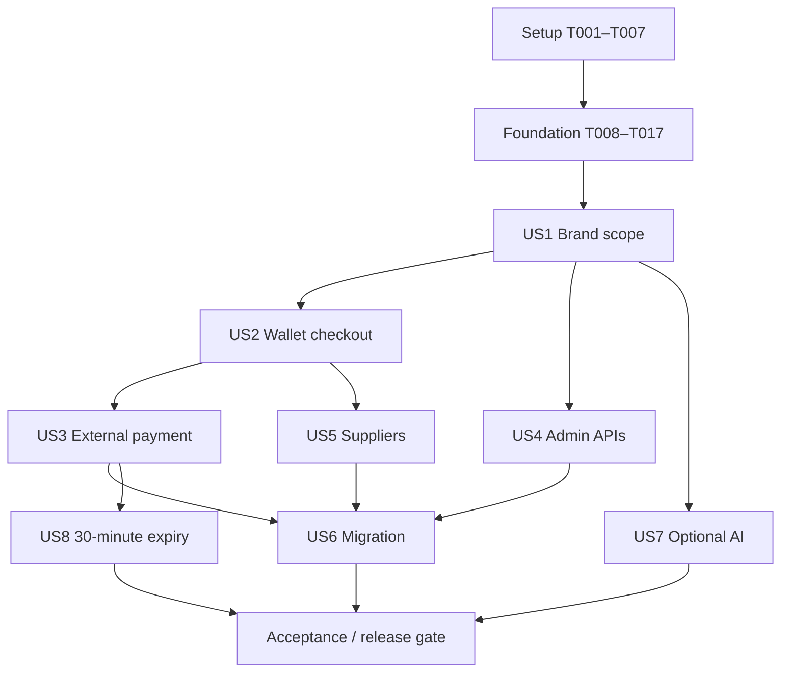

# Tasks: Multi-Brand Commerce Backend Redesign

**Input**: [spec.md](spec.md), [plan.md](plan.md), [research.md](research.md), [data-model.md](data-model.md), [contracts/backend-contracts.md](contracts/backend-contracts.md), [quickstart.md](quickstart.md)  
**Scope**: **Backend only** — no admin/dashboard UI, frontend, or embedded AI answering service.  
**Status**: Proposed implementation backlog in `Farrokhzadeh/telegram-multi-bot-shop`; repository/spec-kit transfer completes setup task T001; the remaining 95 tasks stay unchecked and application implementation remains deferred. No live-data access or deployment authorized.

## Format

`- [ ] TNNN [P] [USn] Description with destination path`

- `[P]`: separable work touching independent paths after its prerequisites, not automatic permission to run parallel agents.
- `[USn]`: maps to the numbered user story in `spec.md`. Setup/foundational/polish tasks have no story label.
- File paths below are targets **to be created in the new repository**, not claims they currently exist.
- Tests for high-risk behavior are required by the specification and must use disposable/synthetic data.

## Phase 1 — Setup and source evidence

**Goal**: Establish a separate backend-only repository and evidence for the exact legacy contract. No production traffic.

- [x] T001 Initialize the user-created `Farrokhzadeh/telegram-multi-bot-shop` repository with `.specify/`, `specs/001-multibrand-redesign/`, `README.md`, and `.gitignore`; copy the agreed spec, plan, tasks and contracts without migrating old app code wholesale. Completed by the owner-authorized specification transfer on 2026-10-29; no application implementation.
- [ ] T002 Create `Platform.sln`, `global.json`, and native-host project files under `src/Platform.Api/`, `src/Platform.BotHost/`, and `src/Platform.JobHost/`, targeting the approved .NET 10 SDK.
- [ ] T003 [P] Create class-library project files in `src/Platform.Core/`, `src/Platform.Persistence/`, `src/Platform.Security/`, `src/Platform.Telegram/`, `src/Platform.Payments/`, `src/Platform.Fulfillment/`, and `src/Platform.Campaigns/` with inward-only dependencies.
- [ ] T004 [P] Initialize `tests/Platform.UnitTests/`, `tests/Platform.IntegrationTests/`, `tests/Platform.ContractTests/`, and `tests/Platform.AotSmoke/` with a disposable Postgres fixture runner and fake Telegram/provider transports.
- [ ] T005 [P] Add pinned package restore, formatting, security/secret scanning and Linux Native AOT publish+run workflow in `.github/workflows/backend-ci.yml`; fail on unexpected trim/AOT warnings.
- [ ] T006 Capture a read-only inventory of legacy source model/DDL migrations, Fernet prefixes/key derivation, payment callbacks, supplier integrations, Telegram callbacks, job handlers and brand environment mapping in `specs/001-multibrand-redesign/contracts/legacy-source-inventory.md`; label source-only versus live evidence.
- [ ] T007 Define release gates, staging identities, immutable artifact rules and protected runtime evidence still required before cutover in `ops/RELEASE_GATES.md`; do not request or copy production keys yet.

**Checkpoint**: New repository foundation and offline source map reviewed; Native AOT skeleton publishes and runs against fake integrations.

## Phase 2 — Foundational (blocks all user stories)

**Goal**: Brand context, data transactions, secrets, encryption and durable effects are safe before commerce endpoints are added.

- [ ] T008 Create explicit reviewed initial schema migration runner, migration-history guard and a PostgreSQL schema assertion rejecting all `json`/`jsonb` columns and EAV/serialized business-state design in `ops/migrations/0001_core.sql`, `src/Platform.Migration/SchemaRunner.cs` and `tests/Platform.IntegrationTests/RelationalSchemaTests.cs`; never apply DDL at daemon startup.
- [ ] T009 Create parameterized Npgsql transaction factory, typed decimal/currency helpers and connection/lease error policy in `src/Platform.Persistence/DbSession.cs` and `src/Platform.Core/Money.cs`.
- [ ] T010 [P] Add trust-bound brand identity (`BrandContext`) and reject customer-supplied brand switching in `src/Platform.Security/BrandContext.cs` and `src/Platform.Api/BrandContextMiddleware.cs`.
- [ ] T011 [P] Implement versioned configuration loading and read-only per-service Docker secret file references for **per-brand keyrings and an independently authorized shared-inventory keyring** in `src/Platform.Security/SecretFiles.cs` and `ops/compose/backend.compose.yaml`; raw keys never appear in database, .env or logs.
- [ ] T012 Implement new authenticated-ciphertext envelope with key ID, random nonce and integrity-bound scope/table/row/field identity in `src/Platform.Security/BrandCipher.cs` and `src/Platform.Security/InventoryCipher.cs`; per-brand secrets bind to brand and unsold shared stock binds to platform-inventory scope. No plaintext fallback.
- [ ] T013 [P] Add migration-only Django Fernet adapter and previous-key/legacy prefix fixtures in `src/Platform.Migration/LegacyFernetReader.cs` and `tests/Platform.ContractTests/LegacyCipherTests.cs`; preserve source-compatible key derivation.
- [ ] T014 [P] Implement redacted structured logs, correlation IDs, error taxonomy and health/readiness policies in `src/Platform.Core/Errors.cs` and `src/Platform.Api/DiagnosticsEndpoints.cs`.
- [ ] T015 Implement unified durable `jobs` table with checked typed origin FKs (no generic payload/reference) for transactional outbox, background leases, retries and dedupe in `ops/migrations/0002_jobs.sql` and `src/Platform.Persistence/OutboxStore.cs`. Review approved restock-subscription typed origin integration under approved table 28 after final constraint review; preserve no-JSON business state and transactional logical-alert dedupe (FR-076).
- [ ] T016 Implement separate `admins`, `admin_sessions` and append-only `audit_events` with global authenticated admins, immediate revocation and redacted privileged-action logging in `src/Platform.Security/AdminAuth.cs`, `src/Platform.Persistence/AdminAuditStore.cs`, and `ops/migrations/0002_auth.sql`; no UI.
- [ ] T017 Validate T008–T016 with wrong-brand, wrong-inventory-key, forbidden bot access to shared inventory cipher, crashed-lease, repeated-write, zero-JSON database metadata and Native AOT executable checks in `tests/Platform.IntegrationTests/FoundationTests.cs` and `tests/Platform.AotSmoke/NativeHostSmokeTests.cs`.

**Checkpoint**: Authenticated brand context, new crypto, legacy reader, typed SQL and durable outbox pass synthetic failure-injection tests. Do not proceed if brand checks can be bypassed.

## Phase 3 — User Story 1: Independently branded customer experience (P1) — MVP

**Goal**: Three bot identities can represent separate customer accounts and data without disclosure of shared ownership.

**Independent Test**: The same Telegram ID appears in all three brands with different balances, languages, orders, blocks and callback states; every customer query stays scoped and a never-started bot cannot message that user.

- [ ] T018 [P] [US1] Write brand isolation and forged-callback tests in `tests/Platform.IntegrationTests/BrandIsolationTests.cs` and `tests/Platform.ContractTests/TelegramContextTests.cs`.
- [ ] T019 [US1] Create typed-policy `brands` (one encrypted bot token per brand), `brand_channels`, and `users(id PK, brand_id, telegram_id BIGINT, UNIQUE (brand_id,telegram_id), UNIQUE (id,brand_id))` with revision-guarded private-DM `users.flow_*` fields in `ops/migrations/0003_brands_users.sql`. `users.id` is a **brand membership**, never global customer identity. **Owner confirmed DM-only interactions; no `telegram_sessions` table in v1.** Follow [database-table-review.md](database-table-review.md).
- [ ] T020 [P] [US1] Implement per-brand user/settings/state repository with enforced composite scope, a single revision-guarded active private-DM flow per brand membership, and `users.telegram_id` private-chat destination lookup in `src/Platform.Persistence/BrandUserStore.cs`.
- [ ] T021 [P] [US1] Implement channel membership rule checks and per-brand localized text/asset lookup in `src/Platform.Telegram/BrandPolicy.cs` and `src/Platform.Telegram/Localization.cs`. Localize FR-075 Out-of-stock status for published supplier listings without exposing raw provider errors. Add localized one-time restock opt-in/unsubscribe labels and informational availability notice without promised dates (FR-076).
- [ ] T022 [US1] Implement verified Telegram update ingestion, brand-scoped command/callback routing and per-bot consumer ownership in `src/Platform.Telegram/UpdateRouter.cs` and `src/Platform.BotHost/Program.cs`. Route FR-076 subscription controls with membership/product brand checks and callback idempotency, after final approved-table-28 persistence review.
- [ ] T023 [US1] Test no foreign brand identifiers, assets, wallets, orders, links or support context appear in any response; add blocked/never-started behavior in `tests/Platform.IntegrationTests/BrandOutputTests.cs`. Verify SC-044 visibility/publication separation and brand-scoped unavailable listing output. Add SC-045 restock-consent and notice brand-isolation/nonfinancial checks.
- [ ] T024 [US1] Create brand-scoped `support_tickets` and append-only `support_messages` with staff assignment, replies, media references and lifecycle constraints in `ops/migrations/0003_support.sql`.
- [ ] T025 [US1] Implement human support ticket/reply routing and durable staff/customer notifications independent of AI, including FR-070 paid-preorder cancellation discussions through checked existing order-linked tickets without a dedicated cancellation endpoint/button or automatic order/queue/financial mutation in `src/Platform.Telegram/HumanSupportRouter.cs` and `src/Platform.Persistence/SupportStore.cs`.
- [ ] T026 [US1] Verify support ticket creation, staff reply, AI-off operation, brand scoping and worker restart, plus SC-039 same-owner order links and creation/reply/assignment/closure/reopening/replay causing no order/queue/coupon/money/stock change in `tests/Platform.IntegrationTests/HumanSupportTests.cs`.

**Checkpoint**: Backend-only brand-isolation MVP works against synthetic data, with no live Telegram connection.

## Phase 4 — User Story 2: Atomic last-item wallet purchase (P1)

**Goal**: Exactly one buyer receives a shared last item with one debit and durable delivery.

**Independent Test**: 50 concurrent buyers, one available credential; exactly one order/debit/allocation. Crash between DB commit and Telegram send causes no second charge.

- [ ] T027 [P] [US2] Write last-unit race, insufficient balance, rollback and replay tests in `tests/Platform.IntegrationTests/AtomicCheckoutTests.cs`.
- [ ] T028 [US2] Create no-JSON `products`, `brand_products` (typed `price_usdt`, `price_toman`, `auto_price_toman`, payment rules and inherit/set/clear overrides), `inventory_items`, **USD-only `wallets(user_id PK)` and immutable `wallet_entries(user_id FK)` without currency columns**, and one-product `orders(user_id,quantity,unit_price_usdt,nullable unit_price_toman/FX snapshots,discount/rounding calculation version,currency,payment_method,payment_due_at,typed product snapshot)` in `ops/migrations/0004_commerce.sql`. **No `orders.total_usdt`, `orders.total_toman`, `orders.brand_id`, `orders.telegram_id`, pricing-mode enum or `payable_usd`.** DB-level brand-match guard must verify `orders.user_id` against `brand_products` and coupons. Do not remove historical `order_items` until source inventory proves safe.
- [ ] T029 [US2] Document verified `main` code semantics in `specs/001-multibrand-redesign/contracts/legacy-commerce-policy-matrix.md`: automatic `best_discount`, one code's `max_uses/current_uses`, product/assigned-user eligibility, both USDT/toman quote paths, Nobitex RLS/10, hourly fetch, ceiling-to-5,000-toman rounding, staleness, `auto_price` opt-out, topup policy and regional payment restrictions. **Verify standalone `PaymentAttempt.kind='wallet_topup'` with nullable order and preserve its typed funding origin.** Record the intentional change from partial coupon use to quantity-entry validation and approved **immutability of each order's payment method/currency**; retain USD wallet units and frozen USDT-to-USD internal credit mapping. Lock **crypto-only wallet top-ups**, TOMAN-only bank/card order settlement and NOWPayments crypto order payment while retaining existing per-brand topup eligibility policy.
- [ ] T030 [US2] Implement typed `discounts`/`discount_uses` preserving **one code with bounded remaining quantity** and one account-bound N-use code per fully paid future-unit purchase (separate batch generation only for campaign/goodwill), prepaid provenance, goodwill/marketing percentages, product/assigned-user scope, server-keyed lookup digest **plus brand-encrypted code for authorized My Discounts/notification display**, guess-rate limits and atomic use caps; add typed signed `discounts.usage_adjustment_units DEFAULT 0` so owner-set effective-used overrides do not mutate real redemption history. **For new prepaid codes require non-null `eligible_user_id`, `product_id`, `source_order_id` with brand/customer/source-paid-order checks: codes are NOT transferable or usable across memberships/brands; promo/goodwill may retain nullable eligibility.** `discount_uses.status` MUST support `held/redeemed/released`, with external-payment holds countable alongside `discounts.redeemed_count` under a serialized coupon lock and no stock reservation; old claims remain auditable. Implement current FX/fetch/lease metadata in `brands` (not `exchange_rates`), source-equivalent Nobitex USDT/RLS conversion and hourly refresh, 5,000-toman ceiling, stale-rate checks and product `auto_price_toman` opt-out in `src/Platform.Core/PricingPolicy.cs`, `src/Platform.Persistence/PricingStore.cs` and `ops/migrations/0004_pricing.sql`; no JSON or historical rate table.
- [ ] T031 [P] [US2] Implement automatic best eligible **whole-quantity-covering** coupon selection for every 10%, 50% and 100% code (no customer opt-out and no partial `min(qty,remaining)`), return `quantity_exceeds_discount_limit` with maximum before order creation **after subtracting effective used (`max(0,redeemed_count + usage_adjustment_units)`) and temporarily held units, clamping new availability to zero even after an owner-imposed overcommitted cap**, USDT/toman calculations using the legacy rounded-rate order, and typed immutable `orders` quote input snapshots (`unit_price_usdt`, nullable toman unit/rate, source/fetched-at, rounding step/calculation version, `currency`, `payment_method`, product text) in `src/Platform.Core/CheckoutQuote.cs`; compute totals from inputs without storing them on orders. Apply FR-077 direct selected-supplier stock/cost/eligibility refresh before new supplier quote/order creation; do not independently overwrite brand retail pricing or old quote snapshots.
- [ ] T032 [P] [US2] Implement product field states `inherit/override/clear`, per-brand visibility and independent USDT/toman price with `auto_price_toman` boolean, retaining manual toman values when automatic conversion is disabled, in `src/Platform.Persistence/CatalogStore.cs`. Apply FR-075: preserve published listings as Out of stock when the selected shared supplier source is unavailable, derive purchase eligibility without changing visibility settings, and block stale new-checkout paths before hold/debit/invoice/zero-due acceptance. After final approved-table-28 constraint review, integrate FR-076 verified availability transitions with durable opt-in evaluation, no automatic publication and local paid-FIFO-first availability.
- [ ] T033 [US2] Implement deterministic-lock-order transaction locking all requested stock units, **automatically selected coupon** with `remaining_uses >= quantity` and wallet only if discounted payable amount is positive; then create one order, per-unit fulfillments, optional debit, all-or-nothing coupon-use increment, allocations and outbox commit in `src/Platform.Payments/WalletCheckoutService.cs`, `src/Platform.Core/OrderIds.cs`, and `src/Platform.Persistence/CheckoutStore.cs`. Recheck coupon quota under lock; if the user requests 11 with 10 eligible uses, return maximum-quantity guidance to the bot and create **no order/failed order**, with no money, stock or coupon mutation. Supplier-backed paths must pass FR-077 fresh source/revision/evidence checks before order/hold/debit creation; local immediate stock allocation remains separate.
- [ ] T034 [US2] Implement credential-part delivery from committed outbox into typed `telegram_deliveries`, with remote-message reconciliation and explicit crash-after-Telegram-send duplicate risk in `src/Platform.Fulfillment/LocalDeliveryWorker.cs` and `src/Platform.Persistence/DeliveryStore.cs`.
- [ ] T035 [US2] Prove atomicity under restarts, 50-way concurrent checkout and three-brand shared inventory access in `tests/Platform.IntegrationTests/CheckoutCrashAndRaceTests.cs`.
- [ ] T036 [US2] Verify two simultaneous redeemers, a **single 100%-off code with 10 uses** prompting maximum-quantity correction for 11 without creating an order in BOTH USDT and toman, quantity 10 succeeding atomically with stock, one 100-unit paid-source purchase issuing exactly one 100%-off code, then 1+9+20 unit redemptions leaving 70 remaining, automatic coupon selection without opt-out, zero-wallet free checkout, coupon nonconsumption on no-stock, 10/50% marketing caps rejecting 11 units when only 10 discounted uses remain, and allowing an audited owner override that lowers a cap below redeemed+held while preserving already held orders, not making mixed-price orders, Nobitex RLS/10, exact 5,000-toman upward rounding *after* automatic discount, hourly/stale-rate handling, disabled auto-price retaining manually set toman **while still accepting independently priced USD wallet/USDT crypto checkout**, and per-brand payment/topup policy in `tests/Platform.IntegrationTests/RegionalPricingTests.cs`. Also test an assigned prepaid coupon is visible and redeemable only by the *original paid source order's* `users.id`; leaked code text, another member in that brand and the same Telegram ID in another brand cannot reveal, hold or redeem it.

**Checkpoint**: Money/stock invariants pass real disposable PostgreSQL tests and compiled Native AOT smoke.

## Phase 5 — User Story 3: Crypto and manual external payments (P1)

**Goal**: Immediate (non-preorder) paid-but-out-of-stock cases never lose funds or become fictitious completed orders.

**Independent Test**: Replay 100 copies of the same paid crypto callback after stock exhaustion; exactly one **USD wallet** credit numerically equal to the frozen discounted USDT `payments.amount_due`, **one release of the order's held coupon uses**, zero final coupon redemptions and zero allocations. Paid manual receipt awaits restock indefinitely unless an admin resolves it.

- [ ] T037 [P] [US3] Write provider-signature, delayed/repeated settlement, quote-vs-token, and no-stock compensation tests in `tests/Platform.ContractTests/PaymentCallbackTests.cs` and `tests/Platform.IntegrationTests/ExternalPaymentTests.cs`.
- [ ] T038 [US3] Create no-JSON `payments` for order-linked NOWPayments crypto/TOMAN bank settlement **and standalone crypto-only wallet funding** using nullable `order_id` and nullable `topup_user_id` FK → `users.id`, with database `CHECK (num_nonnulls(order_id,topup_user_id)=1)` and brand/method checks. For new crypto payments, require `network_asset IN ('USDTTRC20','USDTBSC')`, with source-legacy exceptions recorded only through isolated migration/reconciliation policy. Keep `kind/currency` provisionally until **source/provider denomination** review proves any removal safe. Preserve immutable USD/topup quote, `amount_due/amount_received`, actual `network_asset/network_amount`, scalar NOWPayments IPN verification evidence + protected immutable evidence refs, manual receipt proof/review, before-deadline first-observed evidence, source-linked **USD-wallet** compensation, provider/idempotency uniqueness and checked source-specific states in `ops/migrations/0005_payments.sql`.
- [ ] T039 [US3] Implement verified NOWPayments callback intake for **one shared merchant account across all three brands**, independent crypto wallet-funding settlement with exactly one USD ledger credit, and product order `verified_paid -> (allocate all units + redeem held coupon) OR (zero allocation + one USD wallet credit + release held coupon)` in **one idempotent local DB transaction**, using frozen discounted `payments.amount_due` and versioned order calculations, not a removed `orders.total_usdt`; preserve legacy USD denomination and explicitly test numeric 1:1 USDT-quote-to-USD-wallet credit. `discounts.redeemed_count` MUST NOT increment for compensated/no-stock orders; repeated callbacks can neither re-credit nor release unrelated coupons. Use one platform-scoped credential/IPN secret, globally unique payment references and derive the brand only from persisted order/top-up membership, never callback-supplied brand fields or presentation descriptions. For fully verified full-value late USDT payments on expired/replaced orders, credit the original membership's USD wallet once with frozen quote and leave old status/coupon unfulfilled/released; manually reconcile partial/overpaid/disputed/wrong-network events and late bank transfers. Verify provider asset/network, price currency versus actual pay currency, signature and repeated/late notifications. Never substitute live toman conversion or raw network token quantity in `src/Platform.Payments/CryptoSettlementService.cs`.
- [ ] T040 [US3] Implement manual receipt state machine: submitted, denied-unverified, confirmed-paid, allocated, paid-unfulfilled (no expiry), explicit auditor-traceable administrator off-bot resolution (NO external refund execution, recording or inference in AccAbad; hold remains until separately authorized staff order-state action) in `src/Platform.Payments/ManualDepositService.cs`. Each Iran brand has **exactly one distinct active encrypted receiving card** on `brands`; the **last successfully saved, revision-checked** card immediately becomes the only destination for **new orders**, with stale concurrent admin writes rejected. Bank-payment `payments` freezes its **exact encrypted card/holder destination** before showing instructions; receipt review of earlier pending orders uses that immutable snapshot and original 30-minute deadline even after card replacement. Reject reused active bank-card fingerprints and cross-brand destination access; the international brand need not have a bank card.
- [ ] T041 [US3] Add compensation and receipt status read APIs with no automatic on-chain refund claims in `src/Platform.Api/PaymentEndpoints.cs` and `src/Platform.Api/ManualDepositEndpoints.cs`.
- [ ] T042 [US3] Validate no duplicate **internal USD-wallet credit**, no erased paid liability, repeated approval idempotence and **crypto no-stock compensation atomically returning held discount uses** (e.g., $10 product, 50%-off code, $5 USD wallet credit, one returned coupon use, no stock allocation, no `redeemed_count` increment). Freeze the test clock around coupon expiry: a valid 11:55 PM original held order may fulfill after a midnight campaign expiry, while an order compensated after expiry releases capacity but cannot reuse or renew the expired marketing coupon; no automatic replacement issue, clear notice, and a separately paid 100%-off future-unit entitlement (`ends_at IS NULL`) remains valid. Test 100 late-callback replays auto-crediting one original-brand USD wallet once while old order remains cancelled/expired, and anomalies requiring staff review. Implement in `tests/Platform.IntegrationTests/PaymentStateMachineTests.cs`.

**Checkpoint**: Paid obligations are durable, provider evidence verifiable, compensation exactly once.

## Phase 6 — User Story 4: Unified administration backend (P1)

**Goal**: All brands managed through one secure API, with no graphical UI.

**Independent Test**: One authorized API principal configures all three brands, encrypted bot tokens, required channels, products and overrides, receipts, wallet adjustments and campaigns; ordinary reads reveal no secrets.

- [ ] T043 [P] [US4] Write admin authorization, token-redaction, idempotency and audit contract tests including unrestricted owner edits to coupon percent/caps/effective usage/validity dates even below redeemed+held and on prepaid entitlements, with actor/reason/old-new audit and immutable historical redemption rows in `tests/Platform.ContractTests/AdminApiTests.cs`.
- [ ] T044 [US4] Implement encrypted write-only bot token lifecycle and required-channel configuration in `src/Platform.Api/BrandEndpoints.cs` and `src/Platform.Security/BotTokenVault.cs`.
- [ ] T045 [US4] Implement brand policies and shared catalog/override/price/inventory endpoints in `src/Platform.Api/CatalogEndpoints.cs`.
- [ ] T046 [US4] Implement brand/global order search, payment receipt decisions, wallet adjustment and pending-restock/preorder resolution under FR-070 outside-shop cancellation repayment policy (no cancellation wallet credit/debit reversal or external payout execution/records; retain original payment history) with atomic exactly-once release of all still-held coupon uses (unchanged coupon terms/expiry and no release of redeemed claims), and separately reviewed admin state/hold representation (audited and serialized with allocation; no financial inference from support text/status) and unrestricted owner coupon-edit endpoint for percentage, usage caps, effective used count (`usage_adjustment_units`), expiry/start dates, active state and brand-scoped eligibility (no cap floor or prepaid settlement veto; no automatic off-bot coupon inference) in `src/Platform.Api/OrderAndWalletEndpoints.cs`.
- [ ] T047 [US4] Implement admin audit, campaign, worker health and backlog endpoints in `src/Platform.Api/OperationsEndpoints.cs`.
- [ ] T048 [US4] Freeze generated API contract and ensure pagination/error shapes/permissions in `src/Platform.Api/OpenApiContract.cs` and `tests/Platform.ContractTests/AdminApiSnapshotTests.cs`.
- [ ] T049 [US4] Create typed per-brand/language `campaigns` sharing a `batch_id`, and unified **private-DM-only** `telegram_deliveries` for campaign recipients + order/support outgoing messages, with checked `(brand_id,user_id)` membership FK, **no `chat_id`**, and partial unique `(campaign_batch_id,user_id)` across languages in `ops/migrations/0005_campaigns.sql`. Review checked `product_stock_subscription_id` delivery origin and unique logical alert per subscription under approved table 28 after final constraint review (FR-076); waiting consent is not a campaign recipient row. Include approved table 28 `product_stock_subscriptions` persistence with reviewed timestamp/active-opt-in uniqueness and typed job/delivery origins after implementation authorization; table addition no longer requires approval.
- [ ] T050 [US4] Implement persisted audience materialization into per-campaign `telegram_deliveries` with independently scoped brand/language, typed audience criteria, subscription eligibility and consent snapshot in `src/Platform.Campaigns/AudienceMaterializer.cs`.
- [ ] T051 [US4] Implement throttled, resumable per-bot sender over unified `telegram_deliveries` with **private `chat_id` derived from the recipient's `users.telegram_id`**, Telegram 429 backoff, durable jobs, remote message ID and best-effort suppression after crash-after-send in `src/Platform.Campaigns/BroadcastWorker.cs` and `src/Platform.Persistence/CampaignStore.cs`. Reuse this sender for one-time opted-in restock notices, rechecking consent/publication/stock before first send, deferring the same alert if stock disappears, with existing retry/blocked/uncertain-send handling (FR-076).
- [ ] T052 [US4] Verify campaign cancellation, one recipient per eligible brand **per batch across different language variants**, repeated enqueue, blocked user, 429 and crash/restart delivery in `tests/Platform.IntegrationTests/BroadcastRecoveryTests.cs`; distinguish possible remote duplicate send after an ambiguous Telegram response from duplicate database obligations. Add SC-045 repeated transitions/restart/cancellation/re-opt-in, lost-stock-before-send, no reservation/payment/order/coupon mutation and no duplicate logical-alert checks.

**Checkpoint**: Backend administration is operable from authenticated API clients; no UI project exists.

## Phase 7 — User Story 5: Supplier fulfillment reconciliation (P1)

**Goal**: External API uncertainty never causes silent duplicate fulfillment or premature compensation.

**Independent Test**: Supplier timeout-after-success, confirmed failure and delayed success use one stable external request key and reconcile to one terminal outcome.

- [ ] T053 [P] [US5] Write supplier success/failure/unknown and timeout-after-success replay tests in `tests/Platform.ContractTests/SupplierContractTests.cs`. Include FR-072 / SC-041 bonus, no-bonus, ambiguous-extra, duplicate/reordered response and customer/admin isolation fixtures.
- [ ] T054 [US5] Create one-to-many `supplier_requests(order_id,requested_quantity)` → per-unit `fulfillments(supplier_request_id)` with same-order guards, brand-key encrypted delivered supplier content, stable local supplier intent reference (remote idempotency only when proven), immutable selected source/account/product/variant snapshots, partial/unknown state and protected immutable evidence pointers in `ops/migrations/0006_suppliers.sql`; no provider-state JSON. Also create the owner-approved attempt history from T090. Review typed admin-bonus versus customer-unit attribution and encrypted acquisition storage before DDL; no extra customer unit rows or new table is implicitly approved (FR-072). Review FR-074 immutable acceptance-time supplier-cost amount/currency/quote evidence and typed request-specific override-ceiling/blocker fields in existing relations before DDL; no new table is implied.
- [ ] T055 [US5] Define provider-neutral `ISupplierAdapter` with stable request ID, result categories and status query in `src/Platform.Fulfillment/ISupplierAdapter.cs`.
- [ ] T056 [US5] Implement durable supplier request worker, lease/retry and unknown-result reconciliation in `src/Platform.Fulfillment/SupplierFulfillmentWorker.cs` and `src/Platform.Persistence/SupplierRequestStore.cs`. Route actually verified bonus items to protected admin access with durable, replay-safe attribution; exclude bonus content from customer manifests and ordinary logs/notices, with no extra purchase or automatic stock admission (FR-072). Apply FR-073 zero-due supplier checkout work without admin approval or payment callback, preserving the accepted source/held claim and existing uncertain-outcome reconciliation. Enforce FR-074 inclusive 10% increase against the original same-currency acceptance baseline, including 100%-off orders; block larger/unverifiable cost for admin review without reprice/fallback/compensation or baseline reset, and require an enforceable provider charge ceiling.
- [ ] T057 [US5] Add provider-specific adapters only after sanitized source contract and capability-specific reconciliation/idempotency evidence in `src/Platform.Fulfillment/Providers/`; document provider behavior in `specs/001-multibrand-redesign/contracts/supplier-provider-matrix.md`. Enforce FR-068 ready-account/key/code-only eligibility for exact product/variant at mapping publication and pre-purchase, reject input-collecting activation/slot/upgrade/manual/custom/unknown flows before payable checkout, and retain post-payment type changes for FR-066 administrator review. Specify SC-037 eligibility/type-change fixtures in `tests/Platform.ContractTests/SupplierContractTests.cs` before implementation. Prove provider binding-quote/maximum-charge capability for FR-074; an uncapped catalog-read-then-purchase sequence cannot qualify for automatic procurement. Implement FR-077 read-only direct product refresh before order creation using verified exact product/variant response shapes (fresh product-list read allowed when no detail endpoint exists), failing closed on read/rate-limit/parse errors without provider purchase.
- [ ] T058 [US5] Prove money/fulfillment consistency under duplicated callbacks, unknown/partial batch outcomes and protected paid-unfulfilled remainders in `tests/Platform.IntegrationTests/SupplierRecoveryTests.cs`; never blindly re-purchase the remaining units. Verify SC-041: five customer units plus one protected admin bonus when proven, no customer/bonus overlap, no duplicate bonus or changed order/payment/coupon quantity, no secret leakage, and unchanged complete-order gating. Add SC-042 zero-wallet/full-coupon acceptance, concurrent coupon/source validation, replay, post-acceptance blocker, held-until-full-fulfillment and no fabricated money/invoice/expiry-job checks. Add SC-043 10.00→11.00 allowed / 11.01 blocked, decreases, quantity/fees/currency, free-coupon orders, invalid baselines, nonrolling retry costs, persisted review/override and price-change-at-submit/unknown-outcome fixtures.
- [ ] T059 [US5] Define supplier confirmed-failure default `paid_unfulfilled_requires_admin_resolution` and provider/payment-specific compensation approval matrix in `specs/001-multibrand-redesign/contracts/supplier-failure-policy.md`; do not auto-credit without approved internal-wallet policy; external refunds are always outside AccAbad.
- [ ] T060 [US5] Implement confirmed supplier failure as an auditable retained paid liability and no duplicate compensation, with tests in `src/Platform.Fulfillment/SupplierFailurePolicy.cs` and `tests/Platform.IntegrationTests/SupplierFailureTests.cs`.

**Checkpoint**: Supplier timeouts remain pending reconciliation, not blind refund or duplicate issue.

## Phase 8 — User Story 6: Brand-by-brand historical migration (P1)

**Goal**: Safe, repeatable migration of three independent source databases into one brand-neutral backend with new per-brand encryption keys.

**Independent Test**: Import redacted source fixtures twice with duplicate IDs across stores; counts and opening balances are unchanged on rerun, all required ciphertext decrypts with new key only, and staged stop/snapshot/release is reversible.

- [ ] T061 [P] [US6] Write key-rotation, wrong-key, collision and rerun tests in `tests/Platform.IntegrationTests/LegacyMigrationTests.cs`, reusing legacy Fernet golden fixtures from T013 rather than duplicating a second cipher test suite.
- [ ] T062 [US6] Create stable `(source_brand,table_name,legacy_id) -> canonical_id` mappings and resumable import checkpoint tables in `ops/migrations/0007_legacy_map.sql`.
- [ ] T063 [US6] Implement read-only source adapters and source schema validation against approved protected copies in `src/Platform.Migration/LegacySourceReader.cs`; fail if migrations/schema differ from expected.
- [ ] T064 [US6] Implement repeat-safe historical users/wallet/ledger/orders/payments/coupon obligations/delivery import in `src/Platform.Migration/ImportWorkflow.cs`: verify legacy order line cardinality before omitting `order_items`, freeze one authoritative **USD** wallet opening balance per brand/user membership, preserve historical ledger as non-posting evidence (or verified complete replay, never both), **preserve legacy USD wallet denomination; hard-stop and explicitly reconcile any discovered non-USD wallet liabilities rather than silently coercing them into USD**, preserve encrypted discount codes and current `max_uses/current_uses` even if historical redemptions cannot be fully reconstructed, retain source provenance and prepaid voucher source payments, **hard-stop or quarantine unowned/historically shared prepaid codes for auditable ownership reconciliation rather than guessing an `eligible_user_id`**, import only Brand A active master catalog, and no active stock.
- [ ] T065 [US6] Implement record-wise legacy decrypt → new per-brand authenticated encryption for brand-owned data **or** platform-inventory encryption for authorized shared credentials → decrypt-and-compare, with no plaintext export, in `src/Platform.Migration/ReencryptionWorkflow.cs`; cover retained old previous keys.
- [ ] T066 [US6] Generate redacted reconciliation of wallet balances, paid obligations, historical snapshots, ciphertext counts and unmatched rows in `src/Platform.Migration/ReconciliationReport.cs`.
- [ ] T067 [US6] Define stop-all-writers, webhook/provider handoff, outstanding delivery/payment replay, stock segregation, backup/restore and key escrow in `ops/BRAND_CUTOVER_RUNBOOK.md`.
- [ ] T068 [US6] Rehearse a **single brand only** on isolated staging against scrubbed/authorized source copies; prove rollback and prevent old/new simultaneous stock allocation in `tests/Platform.IntegrationTests/CutoverRehearsalTests.cs` and protected `ops/evidence/` records.
- [ ] T069 [US6] Prove frozen opening balance and non-posting history reconciliation on duplicate imports, wrong currencies and incomplete source ledger in `tests/Platform.IntegrationTests/OpeningBalanceMigrationTests.cs`.
- [ ] T070 [US6] Create protected old-key and encrypted-backup dependency manifest and a retirement gate without key disclosure in `ops/KEY_RETIREMENT_RUNBOOK.md`; no deletion until old snapshots and rollback dependencies expire.

**Checkpoint**: Mandatory owner signoff before any production copy or live payment/bot handoff. Original keys remain recoverable for old encrypted backups and rollback artifacts.

## Phase 9 — User Story 7: Optional independent AI integration (P2)

**Goal**: Commerce and human support operate with AI absent or unavailable.

**Independent Test**: Disconnect optional AI service; Telegram purchase, payment, customer support ticket and fulfillment still work.

- [ ] T071 [P] [US7] Write AI-off, nonmutating context-auth and failure-isolation tests in `tests/Platform.ContractTests/AiBoundaryTests.cs`.
- [ ] T072 [US7] Define a separate versioned read-only AI context/handoff contract in `src/Platform.Api/AiContextEndpoints.cs` and `specs/001-multibrand-redesign/contracts/ai-boundary.md`; exclude wallet/payment/stock/secret mutation.
- [ ] T073 [US7] Implement optional client timeout/circuit policy and human handoff fallback in `src/Platform.Telegram/AiOptionalIntegration.cs`; no AI SDK, model or prompt pipeline inside commerce host.

**Checkpoint**: AI service can be unavailable indefinitely without affecting core commerce.

## Phase 10 — Cross-cutting validation and release readiness

- [ ] T074 [P] Complete all scenario commands and redacted fixture evidence in `specs/001-multibrand-redesign/quickstart.md` and `tests/Platform.AotSmoke/`.
- [ ] T075 [P] Run and document brand-isolation, callback-forgery, secret leakage, media access and admin authorization review in `ops/SECURITY_REVIEW.md`.
- [ ] T076 Prove every published host executable runs under the intended Linux AOT runtime and measured CPU/RSS/startup against the legacy baseline in `ops/PERFORMANCE_EVIDENCE.md`; don't invent absolute requirements before measurement.
- [ ] T077 Verify durable worker restart, 50-buyer last stock, 100-replay crypto settlement, no-JSON relational schema, unified Telegram delivery recovery and supplier reconciliation as one acceptance run in `tests/Platform.IntegrationTests/AcceptanceSuite.cs`.
- [ ] T078 Stress-test the order reference generator from T033 for concurrency and historical ID collision in `tests/Platform.IntegrationTests/OrderIdTests.cs`.
- [ ] T079 Define 95% catalog-to-checkout user acceptance sampling/measurement protocol and evidence template in `ops/USER_ACCEPTANCE_PROTOCOL.md`; publish the result before release.
- [ ] T080 Confirm staging backup/restore, provider identity, old-key escrow, exact source image, frozen schema, brand writer ownership and operator approval in `ops/RELEASE_GATES.md`; hard-stop if any check fails.
- [ ] T081 Obtain explicit separate release decision and prepare immutable staging/canary manifests in `ops/compose/` after all gates; never auto-deploy production from a feature or task completion.

## Payment deadline / lean-identity remediation (US8, must complete before release)

- [ ] T082 [US8] Add `orders.payment_due_at`, `payments.amount_due/amount_received/currency/first_payment_observed_at`, `discount_uses.status(held/redeemed/released)` and `telegram_deliveries.action/target_message_id` to typed migrations; set `users.id` surrogate membership key and remove repeated `brand_id`/`telegram_id` from `orders` and `payments`. Add **one partial unique `orders(user_id)` index for `payment_status='awaiting_payment'`** (per brand membership, not cross-brand Telegram ID) and database-enforced order/listing, discount, support and delivery brand-match guards in `ops/migrations/0003_brands_users.sql`, `ops/migrations/0004_commerce.sql` and `ops/migrations/0005_payments.sql`.
- [ ] T083 [US8] Implement prominent localized "Payment valid for 30 minutes" instruction and exact deadline in bot order creation; schedule `ExpireUnpaidOrder` idempotent work from the same order transaction in `src/Platform.Payments/PaymentExpiryService.cs`. Creating a **valid new order** locks its membership, atomically cancels an older `awaiting_payment` order and releases its coupon hold before committing the new order/quote/hold; invalid replacement leaves old order untouched. Conditional expiry/cancellation only for no-evidence `awaiting_payment`, with timely submitted receipt/observed crypto evidence protected; retain traceability for late payment on cancelled invoices. No stock reservation.
- [ ] T084 [US8] Implement editable payment instruction messages using persisted original Telegram message IDs, deferred edit `telegram_deliveries` intents, throttled retries and fallback on failed edit in `src/Platform.Telegram/PaymentMessageWorker.cs`; **recheck authoritative `expired` or `cancelled` state just before the corresponding edit** so a stale job cannot overwrite a paid message. Customer sees **Failed/Expired** after timer or **Cancelled — replaced** after a successful new order, with separate messages and no revived order.
- [ ] T085 [US8] Test immutable order payment method/currency: switching bank→crypto successfully creates a new order and **cancels the old awaiting-payment order atomically**, releases the old held coupon quota and preserves its original provider identity; an invalid replacement preserves the original order and 30-minute timer. Enforce one awaiting order **per brand membership** across concurrent bot callbacks while permitting separate evidence-under-review and paid obligations; timed receipt/crypto evidence wins races against replacement/expiry without losing real funds. Verify coupon-held vs redeemed caps, 10-use quantity corrections, 100%-free immediate redemption, late payment on cancelled invoices, correct Telegram Cancelled vs Expired edits, 30-minute boundary, restart, late transfer reconciliation, fixed-toman-with-USD-wallet/USDT purchases, standalone NOWPayments crypto-only USD wallet top-ups with no product order, exact XOR payment origin, rejection of card-to-card topups/USD card checkout, repeated provider settlement, verified USD price vs pay-asset evidence, USDTTRC20/USDTBSC-only invoice creation and callback match, rejected TRX/BNB/other-USDT-network, shared-account cross-brand callback spoof/replay rejection, provider-hosted merchant identity review, distinct Iranian bank cards with immutable payment destination and duplicate-card detection, no currency columns on USD wallet/ledger, no delivery `chat_id`, private-DM routing, compact `user_id` brand guards, and exact payment/ledger amounts versus derived historical totals in `tests/Platform.IntegrationTests/PaymentExpiryTests.cs`.

## Owner-approved history and bot activity extensions (design only; future implementation tasks)

**Approval (2026-10-29):** These two typed append-only relations originally extended the design to **25 proposed physical tables**; the separately approved supplier-attempt relation below is table **26**. These checkboxes remain unchecked; no DDL or application changes are authorized by their presence in the backlog.

- [ ] T086 Define `discount_revisions` and `discounts.revision` with typed immutable settings snapshots, initial creation revision, `(discount_id,revision_no)` uniqueness, linked `audit_events` actor/time/reason and same-transaction coupon edit locks; test unrestricted owner override, concurrent redeem/edit, original-order immutability and edit-time actual redeemed/held context.
- [ ] T087 Define `bot_activity_events` with one `users.id` brand-membership owner, typed finite `event_type/source_kind/action_code`, optional checked product/order/support links, source update/flow numbers, timestamp, deterministic `(user_id,idempotency_key)` uniqueness, lookup indexes and no JSON/private-message fields. Finalize a versioned event registry, privacy/access controls and FR-071 owner-approved 180-day UTC retention/query/cleanup index and permission design before executable DDL; other domain/archive/backup retention is separate.
- [ ] T088 Instrument all meaningful authenticated bot actions and real workflow transitions (start, menus, product views, buttons, quantity selection, checkout state, support entry, abandonment, errors) using the typed event registry. Expose paginated, access-controlled `GET /v1/admin/bot-activity` read paths filtered by brand/membership/time/action; keep money/order/domain records authoritative and ordinary bot interaction working if optional analytics reading is unavailable. After implementation authorization, add bounded resumable 180-day expiry maintenance and matching read cutoff on original UTC event time in `src/Platform.Persistence/BotActivityRetentionStore.cs`, with no domain cascade/indefinite raw archive or replay retimestamping; apply cutoff on target restore/import and monitor cleanup backlog/errors.
- [ ] T089 Test duplicated Telegram updates, repeated timeout workers, wrong-brand references, event flood/rate bounds, safe-data redaction, FR-071 / SC-040 180-day UTC cutoff boundary, concurrent inserts, cleanup failure/restart/replay, source/archive isolation, target restore/import re-expiry, no domain deletes and independent financial idempotency after activity expiry, plus typed/reconciled legacy `user_activity` import; confirm no raw DM/callback/secret/coupon/receipt values and that admin coupon creation/edit history cannot diverge from current coupon settings or true redemption rows.

## Owner-approved supplier request attempts and incomplete acquisition (design only; future implementation tasks)

**Approval (2026-10-29):** `supplier_request_attempts` is physical table **26**. An order-level supplier batch may produce multiple encrypted per-unit outputs; a five-unit request returning three stores those items encrypted internally, releases zero to the customer and keeps the whole paid order under administrator review. The later complete-order correction supersedes earlier partial-customer-delivery examples. These tasks are **unchecked and not authorized for implementation**.

- [ ] T090 Specify and eventually migrate `supplier_request_attempts` with typed submit/lookup/export and outcome, `(supplier_request_id,attempt_no)` unique key and immutable terminal evidence; change `supplier_requests.fulfillment_id` to batch `order_id/requested_quantity`, remove duplicated attempt-summary scalars, add same-order `fulfillments.supplier_request_id` guard, immutable brand-key encrypted unit content and optional stable remote-item dedupe. No refund table, provider JSON or new refund endpoint.
- [ ] T091 Implement only after separate authorization and live provider proof: persist a pre-call attempt intent and finalize each provider operation with durable typed/unknown evidence, correlate identical remote orders and batch exports to individually deduped fulfillment units, and distinguish `jobs.attempts` from remote calls; unknown state never causes blind re-purchase.
- [ ] T092 Exercise five requested/three acquired supplier items across timeout, repeated status/export, restart, callbacks and brand isolation; prove three encrypted internal items but zero customer release, full paid/unfulfilled `partial_pending_admin`, all coupon uses held and no automatic purchase/credit/refund. With a complete verified set and review clearance, prepare one five-unit manifest and redeem the whole claim once. Prove credential/file/history access guards and transport recovery; preserve historical partial-delivery evidence separately. FR-063/067, SC-031/036.

## Approved source selection and local-preorder FIFO follow-up (design review only)

All entries remain unchecked. Implementation tasks are future backlog, require a later explicit instruction and depend on closing their schema/policy gates.

- [ ] T093 Finalize the owner-approved table 27 `product_supplier_sources` constraints/indexes, null-aware mapping uniqueness, same-product active-selection guards, referenced mapping lifecycle and source-revision provenance, owner-approved one-account-per-provider configuration and historical account identity, owner-approved shared master-product selection across all three brands without overrides, one checked product-level active selection and FR-066 accepted-payment binding/blocker-field design in `specs/001-multibrand-redesign/contracts/supplier-provider-matrix.md`; table addition is approved and the current baseline is 28. Review exact constraints/config before any executable DDL or implementation.
- [ ] T094 [US5] After implementation authorization, implement approved `product_supplier_sources` persistence, audited revision-checked selection and immutable request source-ID/revision/account/product/variant snapshots in `src/Platform.Fulfillment/SupplierSourceSelection.cs`, with FR-068 mapping publication/pre-purchase eligibility, SC-037 excluded/unknown product and post-payment type-change tests, mapping uniqueness/same-product/referenced-history guards, accepted-payment binding (wallet/crypto/bank), unpaid-order source switches, 100-callback replay, source/payment races, same-account credential rotation and different-account replacement blocking, one configured account reused across products/brands without account pools or credential copies, disabled/missing/unavailable-source paid admin review without fallback/credit, re-enablement review protection, variant, all-three-brand source switching/no-per-brand-override and old-request reconciliation tests in `tests/Platform.IntegrationTests/SupplierSourceSelectionTests.cs`. No automatic fallback or split purchase; FR-064/066/068 / SC-033/035/037. Include FR-073 no-payment-required checkout as the zero-due source-binding point, with transactional whole coupon hold/order acceptance/request/outbox and SC-042 replay/source-race validation. Persist the reviewed FR-074 supplier-cost baseline at accepted payment or zero-due acceptance with the selected source; later source edits/retries cannot rebase the cost guard. Include FR-075 / SC-044 unavailable-source catalog status and checkout blocking, verified supply recovery without fallback or auto-publication, and preservation of old accepted-order review state. Add SC-046 direct-refresh/source-revision/creation races, failed-refresh zero-mutation, all checkout methods, duplicate-request immutability and later binding/procurement recheck fixtures.
- [ ] T095 [US9] After implementation authorization and policy/schema review, implement fully paid local-preorder FIFO across shared-product brand memberships, serialized checkout/restock allocation, whole-order obligations, no partial allocation/reservation or smaller-order bypass, transactional drain work and complete-manifest delivery links in `src/Platform.Fulfillment/LocalPreorderAllocator.cs`; immediate-sale and supplier-shortfall rules stay distinct. Apply revised FR-069: no admin availability/ETA/deadline/duration or quoted-date snapshot fields and no date-change/paid-fulfillment-expiry job; paid orders wait indefinitely for full stock or explicit authorized resolution, while technical audit/FIFO times and unpaid invoice deadlines remain; FR-065/069.
- [ ] T096 [US9] Specify then, after implementation authorization, exercise A-five/B-two oldest-paid ordering, unpaid older quotes, three-step restocking (3 then 3 then 1) with no partial release, concurrent payment/allocation and worker crashes/replay, each payment method, timer protection and brand privacy in `tests/Platform.IntegrationTests/LocalPreorderTests.cs`. Verify whole-claim coupon redemption, complete-manifest access and transport recovery, revised FR-069 no-date schema/admin/customer/quote contracts, absence of date-change/paid-expiry jobs, indefinitely pending paid FIFO and separate unpaid payment expiry (SC-038); exercise FR-070 support-request non-mutation, actual admin-resolution/allocation races and approved cancellation replay with no wallet credit/debit reversal, payout call/record or assertion of repayment completion, preserving original payment/debit history; test full atomic held-coupon release, 100 approval replays, rollback and allocation races, expired/disabled/reduced-cap coupons, unchanged redeemed facts/usage adjustments and no release of already redeemed claims (SC-039); review remaining admin cancellation state/hold transition design and historical staging partial-order compatibility before DDL; SC-034/036/038/039 and FR-067/069/070.

## Dependencies and Order

- **Setup → foundation is mandatory.** No user story begins before the key, DB, auth, brand and outbox foundations pass.
- **US1 MVP**: brand-scoped bots and customer state without purchases can be independently tested; it is *not production-deployable* until money, migrations and operator gates are satisfied.
- **US2** depends on US1 brand context, but its atomic purchase service is tested independently from Telegram delivery.
- **US3** depends on US2 allocation and ledger; US4 administration and US5 supplier adapters can be developed after core contracts are stable.
- **US6** uses completed payment/catalog/order contracts; no live cutover before all P1 acceptance checks.
- **US7** is independent optional integration and may be deferred without breaking purchase/human support.
- **US8** depends on US3 payment records and US1 brand membership; its expiry + Telegram-edit test gate is mandatory before release.
- **US9** depends on schema/policy gates in T093/T096, US2 stock/ledger, US3 verified payment and US1 delivery context. T094 depends on T093 account/snapshot/blocker design and US3 accepted-payment verification. Local FIFO does not change supplier manual-review defaults.

## Parallel Opportunities

After their prerequisites are complete, file-disjoint `[P]` tasks can be worked on concurrently. Examples:

- Foundation T010 brand trust, T011 secret loader, T013 legacy cipher test fixtures and T014 diagnostics touch independent components.
- US1 T020 user repository and T021 language/channel rules can proceed after T019 schema is agreed.
- US2 T031 quote rules and T032 catalog projection can proceed after schema T028 and approved pricing-policy matrix T029/T030.
- US4 API contract tests T043 can be prepared while the administration endpoints are implemented.
- US6 T061 synthetic fixture tests may be authored before migration implementation, without access to production keys.

Do not parallelize writes to the same migration file, wallet/stock authority, provider idempotency index, or live brand credentials. The checkbox list is a dependency order, not permission for concurrent production operations.

## Implementation Strategy

1. **Foundation**: Build only the native backend solution and disposable DB/fixture environment.
2. **MVP demonstration**: Prove three independent bot contexts (US1) using fake Telegram input and brand-scoped profiles.
3. **Financial engine**: Implement and stress-test last-item atomic checkout (US2) and externally paid compensation (US3).
4. **Operational backend**: Admin APIs and supplier reconciliation (US4/US5); no graphical UI.
5. **Migration rehearsal**: Source-only compatibility proof followed by separately authorized protected schema/key tests and staged brand cutover (US6).
6. **Optional AI boundary**: Implement only if/when a separate service integration is needed (US7).
7. **Release**: Immutable staged artifacts, restore proof, reconciliation, human approval; no automatic promotion.

## Coverage and Gate Summary

| Story | Task range | Count | Minimum independent acceptance |
|---|---|---:|---|
| Setup | T001–T007 | 7 | New backend solution AOT publishes and legacy contracts are inventoried |
| Foundation | T008–T017 | 10 | Scoped auth, cipher and outbox tests pass |
| US1 | T018–T026 | 9 | No cross-brand data leaks in three bot contexts |
| US2 | T027–T036 | 10 | 50 buyers, one allocation, one debit |
| US3 | T037–T042 | 6 | 100 callback replays, one USD-wallet credit |
| US4 | T043–T052 | 10 | All-brand authenticated API with audit and secret redaction |
| US5 | T053–T060 | 8 | Supplier uncertainty reconciled without duplicate issue |
| US6 | T061–T070 | 10 | Repeat-safe historical migration, verified crypto and cutover rollback |
| US7 | T071–T073 | 3 | Core flows run with AI absent |
| Cross-cutting | T074–T081 | 8 | All quality/release gates pass |
| US8 | T082–T085 | 4 | 30-minute expiry and editable Telegram message; late-money and tenant-FK safety |
| Owner-approved histories | T086–T089 | 4 | Coupon edit revisions and customer activity have typed, idempotent, brand-safe evidence |
| Supplier attempts/incomplete acquisition | T090–T092 | 3 | One request → many encrypted internal units; attempt history; 3-of-5 releases zero and awaits admin |
| Supplier source review/selection | T093–T094 | 2 | Typed source design and manual selection with immutable request binding |
| US9 local-preorder FIFO | T095–T096 | 2 | Oldest-paid complete-order allocation, no bypass/partial release, replay and brand safety |
| **Total** | **T001–T096** | **96** | **No implementation or production permission implied** |

## Explicit Exclusions

- No admin UI/frontend or admin panel screen navigation.
- No embedded AI provider/model answering implementation.
- No cross-brand wallet merging, automatic foreign catalog imports, long-lived checkout reservations or unverified external crypto refunds.
- No production data, keys or deployment until separately authorized and rehearsed.
